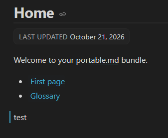
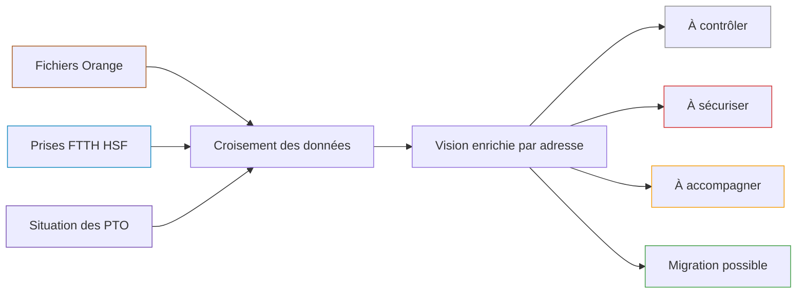
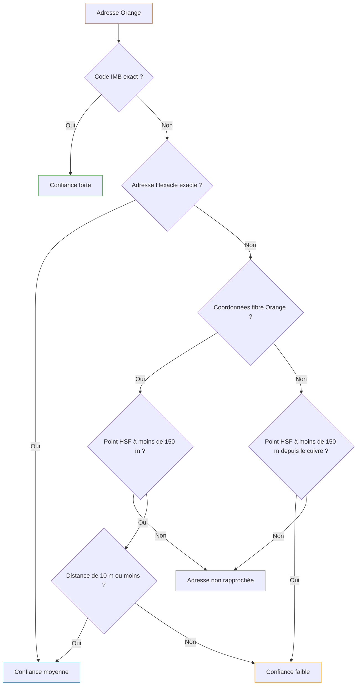
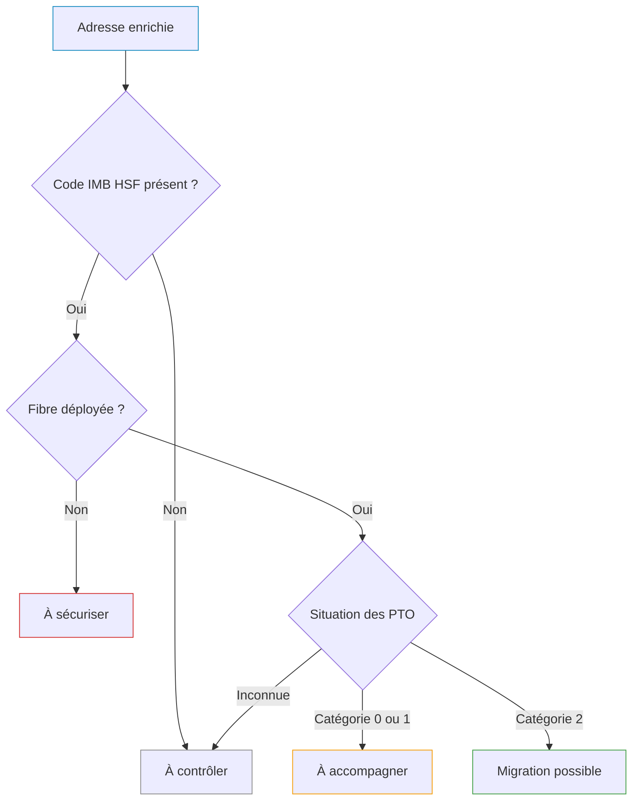

# portable.md Editor draft

Text above the first portable.md header is preserved but not rendered by portable.md.
<!--pmd
id:"home"
title:"Home"
kind:"home"
tags:"start"
journey:"Getting started"
updated:"2026-10-28"
-->
# Accueil

Ceci est un projet de test pour commencer à faire une base de connaissance tout en testant l'outil.  

> [!TIP]
> Ce document comporte plusieurs pages, exemples :  
> [Analyse Cuivre - Fibre](#/technique/analyse_cuivre_fibre)  
> [Suivi MT Voirie](#/communication/suivi_mt_voirie)
<!--pmd
id:"technique"
title:"Technique"
kind:"simple"
parent:"home"
updated:"2026-10-28"
-->

<!--pmd
id:"communication"
title:"Communication"
kind:"simple"
parent:"home"
updated:"2026-10-28"
-->

<!--pmd
id:"suivi_mt_voirie"
title:"Suivi MT Voirie"
parent:"communication"
updated:"2026-10-28" "France et Erwan"
-->
# Suivi MT Voirie

> [!NOTE]  
   Besoin d'accompagner les collectivités ayant souscrits à l'outil [Mon Territoire Voirie](https://monterritoire-voirie.geo70.fr/territory.php)

#### ++Liste des collectivités++ 
- Communes :
    - Fresse (Code INSEE : 70256) 
    - Montot (Code INSEE : 70368)
    - Saint-Sauveur (Code INSEE : 70473)
    - Ternuay-Melay-et-Saint-Hilaire (Code INSEE : 70498)
    - Saint-Rémy-en-Comté (Code INSEE : 70472)
 - EPCI :
    - CC Pays de Villersexel (Code SIREN : 247000714)
    - CC Terres de Saône (Code SIREN : 200041879)
 - Syndicats :
     - Syndicat de voirie du Val de Saône (Code SIREN : 257001537)

---

## Premières étapes de l'accompagnement
1) Présentation de l'outil aux collectivités
2) Formation des collectivités
3) Distribution de documentation numérique

##### Présentation de l'outil aux collectivités

| Collectivité | Agent mobilisé | Date convenue | Réfèrent | Présentation validée? |
| :---: | :---: | :---: | :---: | :---: |
| Saint-Sauveur | France | Value | Value | [?] Oui |
| Montot| France | Value | Value | [?] Oui |
| Ternuay-Melay-et-Saint-Hilaire | France | Value | Value | [?] Oui |
| Fresse | France | Value | Value | [?] Oui |
| Saint-Rémy-en-Comté | France | Value | Value | [?] Oui |
| CC Pays de Villersexel | France | Value | Value | [?] Oui |
| CC Terres de Saône | Erwan | Value | Value | [?] Oui |
| Syndicat de voirie Val de Saône | Erwan | Value | Value | [?] Oui |

>[!NOTE]
> Mise en place d'un sondage pour que les participants puissent choisir leur créneau.  
> [Lien du sondage (France)](https://rallly.co/invite/us9IMeMAQ7mK) *if u want*  
> Identifiant : france.bringard@hautesaonenumerique.fr  
> Mot de passe : ||REDACTED||

###### Proposition par mail (France)

:::spoiler Click to reveal

:::
 
###### Proposition par mail (Erwan)  
:::spoiler Click to reveal  

:::  
##### Formation des collectivités
*

*
>
<!--pmd
id:"analyse_cuivre_fibre"
title:"Analyse Cuivre - Fibre"
parent:"technique"
updated:"2026-10-27" "Erwan"
-->

# Analyse des accès cuivre actifs et de leur situation fibre

## 1. Objectif du projet

Le projet vise à localiser les adresses disposant encore d'au moins un accès cuivre actif, à les rapprocher des données fibre disponibles, puis à qualifier leur niveau de préparation à la migration vers la fibre.

Le résultat constitue une aide à l'analyse pour HSN, HSF et les collectivités. Il doit permettre de distinguer rapidement :

- les adresses pour lesquelles la migration paraît possible ;
- les adresses où un équipement PTO reste à vérifier ou à réaliser ;
- les adresses dont la situation fibre doit être contrôlée ;
- les adresses dont le déploiement fibre n'est pas encore terminé et qui doivent être sécurisées avant la fermeture du cuivre.

Cette analyse ne prouve ni l'existence d'un abonnement fibre actif, ni l'absence d'un abonnement fibre. Elle croise des données d'infrastructure et des adresses disposant encore d'un accès cuivre actif. Le raccordement réel d'un logement et la souscription de l'occupant restent deux notions distinctes.

:::info Lecture rapide
La couche principale associe une adresse cuivre Orange à l’adresse fibre HSF jugée la plus pertinente. Les symboles indiquent ensuite la priorité de migration, le statut fibre, la situation des PTO et le nombre de logements.
:::

### Lire rapidement la carte

| Symbole | Signification |
|---|---|
| :point_cuivre_orange: | Adresse disposant encore d’au moins un accès cuivre actif |
| :point_fibre_orange: | Position fibre transmise par Orange, lorsqu’elle est exploitable |
| :point_fibre_hsf: | Adresse ou immeuble fibre HSF retenu par le rapprochement |
| :lien_orange_categorie_1: | Déplacement entre les coordonnées cuivre et fibre Orange |
| :lien_hsf_confiance_forte: | Lien entre l’adresse cuivre et le point HSF retenu |

[TODO] Ajouter une capture de Mon Territoire Carto à une échelle locale montrant simultanément les trois points, les deux liens et les étiquettes de distance.

[TODO] Ajouter une courte vidéo montrant le parcours utilisateur : ouvrir un point HSF, parcourir les trois onglets, puis comparer les coordonnées HSF et Orange.

## 2. Données utilisées

| Source | Emplacement | Contenu utile | Rôle dans l'analyse |
|---|---|---|---|
| Fichiers mensuels Orange | `in/adresses_actives_*.xlsx` | Adresse cuivre, accès cuivre actifs, coordonnées cuivre, éventuelles coordonnées fibre Orange, codes IMB et Hexacle, opérateur, distance et indice de confiance Orange | Point de départ de l'analyse et localisation des accès cuivre actifs |
| Prises FTTH HSF | Base `hsn_fibre.prises_ftth` | Adresse et coordonnées de l'immeuble, état du déploiement, nombre de logements, informations du point de mutualisation | Référence fibre HSF et qualification de l'éligibilité |
| Situation des PTO HSF | Base `hsn_fibre.imb_sans_pto` | Catégorie PTO agrégée par immeuble, nombre de logements et coordonnées | Qualification de la situation des PTO |

Les fichiers `out/prises.parquet` et `out/pto.parquet` sont des extractions techniques des deux sources HSF. Ils facilitent les contrôles, mais FME lit les tables HSF directement en base.

:::figure Sources mobilisées et résultats de l’analyse {#flux-donnees}

:::

### État du jeu de travail actuel

| Élément | Nombre d'entités |
|---|---:|
| Adresses cuivre analysées | 66 |
| Références fibre Orange disposant de coordonnées | 63 |
| Références fibre HSF rapprochées | 66 |
| Lignes cuivre vers fibre Orange | 63 |
| Lignes cuivre vers fibre HSF | 66 |

Ces nombres correspondent à l'export de travail actuel et évolueront avec les mises à jour mensuelles.

Point d'attention : 14 classeurs sont présents dans `in`, mais le workspace FME en référence actuellement 13. `adresses_actives_vregille.xlsx` n'est pas inclus dans la sélection FME actuelle.

## 3. Couches produites

| Visuel | Couche publiée | Table PostGIS | Export de contrôle | Géométrie | Usage et rendu |
|---|---|---|---|---|---|
| :point_cuivre_orange: | Points cuivre Orange | `hsn_fibre.analyse_cuivre_pt_cuivre` | `out/pt_cuivre_orange.parquet` | Point | Position de l'accès cuivre actif, symbole cuivre brillant, une fiche d'information |
| :point_fibre_orange: | Optionnel - Données fibre | `hsn_fibre.analyse_cuivre_pt_fibre_orange` | `out/pt_cuivre_fibre_orange.parquet` | Point | Position fibre transmise par Orange, symbole orange brillant, une fiche d'information |
| :point_fibre_hsf: | Analyse cuivre Orange - fibre HSF | `hsn_fibre.analyse_cuivre_pt_fibre_hsf` | `out/pt_cuivre_fibre_hsf.parquet` | Point | Couche principale enrichie, symbole bleu, indicateurs de priorité, de statut fibre, de PTO et nombre de logements |
| :lien_orange_categorie_1: | Optionnel - Distance fibre Orange | `hsn_fibre.analyse_cuivre_distance_fibre_orange` | `out/distance_cuivre_fibre_orange.parquet` | Ligne | Comparaison entre le point cuivre et la position fibre Orange, ligne orange avec distance |
| :lien_hsf_confiance_forte: | Distance cuivre Orange - fibre HSF | `hsn_fibre.analyse_cuivre_distance_fibre_hsf` | `out/distance_cuivre_fibre_hsf.parquet` | Ligne | Lien entre le point cuivre et le point HSF retenu, ligne bleu clair avec distance et niveau de confiance |

Les lignes sont des objets d'analyse. Elles représentent un déplacement géographique entre deux coordonnées, pas le tracé réel d'un réseau ni un itinéraire de raccordement.

:::figure Aperçu des points et des liens à l’échelle locale {#apercu-couches}

:::

[TODO] Remplacer cet aperçu QGIS par une capture définitive de Mon Territoire Carto lorsque la symbologie et les noms de couches seront validés en production.

## 4. Chaîne de traitement

### 4.1 Préparation

1. Les fichiers Orange sont regroupés et chaque ligne reçoit un identifiant `hsn_id_adresse`.
2. Les coordonnées Orange sont transformées en points.
3. Les comparaisons de distance sont réalisées en projection métrique EPSG:2154.
4. Les données HSF `prises_ftth` et `imb_sans_pto` sont préparées pour les rapprochements.

### 4.2 Hiérarchie de rapprochement avec HSF

Le premier rapprochement réussi est conservé.

| Ordre | Méthode | Règle | Confiance HSN |
|---:|---|---|---|
| 1 | Code IMB | Correspondance exacte entre le code IMB Orange et le code IMB HSF | Forte |
| 2 | Code adresse Hexacle | Correspondance exacte entre la clé d'adresse Orange et la clé d'adresse HSF | Moyenne |
| 3 | Proximité sur coordonnées fibre Orange | Immeuble HSF le plus proche dans le même code INSEE, à 150 m maximum | Moyenne jusqu'à 10 m, faible au-delà |
| 4 | Proximité sur coordonnées cuivre | Utilisée lorsque les coordonnées fibre Orange sont absentes ; immeuble HSF le plus proche dans le même code INSEE, à 150 m maximum | Faible |

Le rapprochement géographique retient un seul candidat, le plus proche. La limite à la même commune INSEE réduit le risque de rattacher une adresse à un immeuble situé dans une commune voisine.

Répartition actuelle :

| Méthode | Nombre d'adresses |
|---|---:|
| Code IMB | 31 |
| Code adresse Hexacle | 17 |
| Proximité sur coordonnées fibre Orange | 15 |
| Proximité sur coordonnées cuivre | 3 |

### 4.3 Enrichissement et publication

Après le rapprochement, FME :

1. ajoute les informations de l'immeuble et du point de mutualisation HSF ;
2. recherche la situation PTO associée au code IMB ;
3. calcule les champs d'analyse préfixés `hsn_` ;
4. construit les trois couches de points et les deux couches de lignes ;
5. calcule la longueur des lignes en mètres ;
6. publie les tables PostGIS utilisées par Mon Territoire Carto.

## 5. Transparence algorithmique et rendu final

### 5.1 Source de référence du rapprochement

Le champ `hsn_source_reference` indique le point Orange utilisé pour la recherche par proximité.

| Valeur | Signification | Effectif actuel |
|---|---|---:|
| `fibre Orange` | Les coordonnées fibre fournies par Orange ont servi de référence | 63 |
| `cuivre` | Les coordonnées fibre Orange étaient absentes ; les coordonnées cuivre ont servi de référence | 3 |

Cette valeur est informative dans la fiche de la couche HSF. Elle ne modifie pas directement le symbole ponctuel, mais intervient dans le calcul de la confiance.

### 5.2 Méthode et confiance du rapprochement HSN

Le champ `hsn_methode_rapprochement` décrit la méthode. Le champ `hsn_confiance_rapprochement` traduit sa robustesse pour le rendu de la ligne HSF.

| Visuel | Confiance | Cas concernés | Effectif actuel | Rendu de la ligne HSF |
|---|---|---|---:|---|
| :lien_hsf_confiance_forte: | `forte` | Correspondance exacte par code IMB | 31 | Ligne bleu clair continue |
| :lien_hsf_confiance_moyenne: | `moyenne` | Correspondance exacte par Hexacle ou proximité depuis la fibre Orange à 10 m maximum | 31 | Ligne bleu clair en tirets |
| :lien_hsf_confiance_faible: | `faible` | Proximité depuis la fibre Orange au-delà de 10 m ou depuis le point cuivre | 4 | Ligne bleu clair en pointillés |

Une confiance faible ne signifie pas que le rapprochement est faux. Elle signifie qu'il doit être vérifié plus attentivement.

### 5.3 Indice de confiance Orange

Le champ `orange_confiance_rapprochement` provient directement des fichiers Orange. Il est distinct de la confiance HSN décrite ci-dessus.

| Visuel | Valeur visible dans la couche de ligne Orange | Interprétation cartographique | Rendu |
|---|---|---|---|
| :lien_orange_categorie_1: | `Categorie 1` | Confiance Orange la plus élevée parmi les points fibre Orange représentés | Ligne orange continue |
| :lien_orange_categorie_2: | `Categorie 2` | Confiance Orange plus faible | Ligne orange en tirets |

Les critères détaillés qui distinguent les catégories Orange ne sont pas recalculés par HSN et doivent être confirmés dans la documentation du fournisseur. Les catégories 3 et 4 peuvent rester présentes dans les attributs de la couche HSF, notamment lorsque la position fibre Orange n'est pas exploitable pour créer le point Orange.

### 5.4 Éligibilité fibre synthétique

Le champ `hsn_fibre_eligible` est calculé à partir de `hsf_statut_fibre`.

| Condition | Valeur produite | Effet final |
|---|---|---|
| `hsf_statut_fibre = DEPLOYE` | `Oui` | L'adresse est considérée comme éligible dans l'analyse |
| Toute autre situation | Champ non renseigné | Le statut détaillé HSF et la priorité doivent être consultés |

Le traitement ne produit pas actuellement de valeur explicite `Non`. Une valeur vide ne doit donc pas être interprétée seule comme une non-éligibilité certaine.

Dans le jeu actuel, les 66 adresses rapprochées ont la valeur `Oui`.

### 5.5 Statut fibre affiché comme « statut de la prise »

Le petit cercle placé en bas à gauche du point HSF utilise le champ `hsf_statut_fibre`, issu de l'état d'immeuble HSF.

| Visuel | Valeur HSF | Libellé cartographique | Couleur |
|---|---|---|---|
| :statut_eligible: | `DEPLOYE` | Éligible | Vert |
| :statut_cible: | `CIBLE` | Cible | Bleu |
| :statut_raccordable_demandee: | `RACCORDABLE DEMANDE` | Raccordable demandée | Jaune |
| :statut_signee: | `SIGNE` | Signée | Orange |
| :statut_en_cours_de_deploiement: | `EN COURS DE DEPLOIEMENT` | En cours de déploiement | Violet |
| :statut_rad_en_cours_de_deploiement: | `RAD EN COURS DE DEPLOIEMENT` | RAD en cours de déploiement | Rouge |
| :statut_abandonnee: | `ABANDONNE` | Abandonnée | Gris |

Le libellé visuel « statut de la prise » est simplifié. Techniquement, le champ décrit l'état fibre de l'immeuble ou de l'adresse HSF, pas l'état contractuel d'une prise chez un occupant.

### 5.6 Situation des PTO

Le champ source `hsf_pto_categorie` est traduit dans `hsn_situation_pto`.

| Visuel | Catégorie HSF | Valeur HSN | Sens métier | Rendu autour du point HSF |
|---|---|---|---|---|
| :pto_aucun: | `0 - IMB sans PTO` | `Aucun PTO` | Aucun PTO connu dans l'immeuble | Contour rouge discontinu |
| :pto_au_moins_un_logement_sans: | `1 - IMB avec au moins 1 logement sans PTO` | `Au moins un logement sans PTO` | L'immeuble comporte au moins un logement sans PTO | Contour orange continu |
| :pto_aucun_logement_sans: | `2 - IMB sans logement sans PTO` | `Aucun logement sans PTO` | Aucun logement n'est identifié comme restant sans PTO | Pas de contour supplémentaire |
| :pto_inconnu: | `PTO_inconnu` | `Inconnue` | Aucune situation PTO n'a pu être associée | Pas de contour spécifique et priorité à contrôler |

Cette information porte sur la présence connue d'un PTO. Elle ne prouve pas qu'un abonnement fibre est actif.

Répartition actuelle : 37 adresses sans PTO, 4 avec au moins un logement sans PTO, 24 sans logement restant sans PTO et 1 situation inconnue.

### 5.7 Priorité de migration

Le champ `hsn_priorite_migration` applique les règles suivantes dans l'ordre.  

La première règle satisfaite est retenue.

| Visuel | Ordre | Condition | Classe | Rendu sur le point HSF | Effectif actuel |
|---|---:|---|---|---|---:|
| :priorite_a_controler: | 1 | Aucun code IMB HSF rapproché | `À contrôler` | Losange gris en haut à gauche | 0 |
| :priorite_a_securiser: | 2 | Statut fibre HSF différent de `DEPLOYE` | `À sécuriser` | Losange rouge en haut à gauche | 0 |
| :priorite_a_accompagner: | 3 | Catégorie PTO 0 ou 1 | `À accompagner` | Losange orange en haut à gauche | 41 |
| :priorite_migration_possible: | 4 | Catégorie PTO 2 | `Migration possible` | Losange vert en haut à gauche | 24 |
| :priorite_a_controler: | 5 | Situation PTO inconnue | `À contrôler` | Losange gris en haut à gauche | 1 |

La classe est une aide à la priorisation. Elle ne remplace pas une vérification terrain ou une instruction opérationnelle du raccordement.

### 5.8 Distances

Deux notions de distance sont conservées :

| Champ | Calcul | Usage |
|---|---|---|
| `hsn_distance_rapprochement_m` | Distance entre le point de référence Orange retenu et le candidat HSF | Contrôle de la qualité du rapprochement HSF |
| `hsn_distance_cuivre_fibre_m` | Longueur de la ligne entre le point cuivre et le point fibre représenté | Étiquette cartographique en mètres sur les couches de lignes |
| `orange_distance_cuivre_fibre_m` | Distance fournie par Orange entre ses positions cuivre et fibre | Information de comparaison dans les fiches |

Les couches de lignes et leurs étiquettes sont limitées aux échelles locales, jusqu'au 1:25 000, pour éviter de surcharger la carte.

### 5.9 Composition du symbole HSF

Le symbole principal rassemble quatre informations sans modifier la position du point :

- :point_fibre_hsf: point central bleu : position de l'immeuble HSF retenu ;
- :priorite_a_accompagner: losange en haut à gauche : priorité de migration ;
- :statut_eligible: cercle en bas à gauche : statut fibre HSF ;
- :pto_aucun: contour autour du point : situation des PTO ;
- nombre placé à droite : nombre de logements HSF.

:::figure Légende complète du symbole HSF {#legende-symbole-hsf}
 
:::

### 5.10 Organisation des fiches de consultation

Les champs suivent le même ordre fonctionnel dans toutes les fiches : résultat métier, adresse, rapprochement, informations techniques, coordonnées, identifiants, puis traçabilité. Les champs techniques de la plateforme (`sogefi_identifiant`, `id_sogefi`, `insee`, `geom` et `geom_label`) restent masqués.

Les deux couches de lignes n’ont pas de fiche de consultation. Leur distance et leur confiance sont déjà portées par la carte.

:::spoiler Points cuivre Orange · onglet « Accès cuivre Orange »

| Nom du champ | Libellé utilisateur |
|---|---|
| `hsn_priorite_migration` | Priorité de migration |
| `hsn_fibre_eligible` | Éligibilité à la fibre |
| `hsn_situation_pto` | Situation des PTO |
| `orange_numero_cuivre` | Numéro de voie |
| `orange_voie_cuivre` | Voie |
| `orange_commune` | Commune |
| `orange_code_insee` | Code INSEE |
| `orange_nb_acces_cuivre` | Nombre d’accès cuivre actifs |
| `orange_cuivre_x` | Coordonnée cuivre X |
| `orange_cuivre_y` | Coordonnée cuivre Y |
| `orange_cle_imb` | Code IMB Orange |
| `hsf_cle_imb` | Code IMB HSF correspondant |
| `orange_cle_adresse` | Clé d’adresse Orange |
| `hsf_cle_adresse` | Clé d’adresse HSF correspondante |
| `orange_code_rivoli` | Code RIVOLI |
| `orange_hexacle_voie` | Code Hexacle de la voie |
| `hsn_id_adresse` | Identifiant de l’analyse |

:::

:::spoiler Analyse cuivre Orange - fibre HSF · onglet « Analyse HSN »

| Nom du champ | Libellé utilisateur |
|---|---|
| `hsn_priorite_migration` | Priorité de migration |
| `hsn_fibre_eligible` | Éligibilité à la fibre |
| `hsn_situation_pto` | Situation des PTO |
| `hsn_confiance_rapprochement` | Confiance du rapprochement |
| `hsn_methode_rapprochement` | Méthode de rapprochement |
| `hsn_distance_rapprochement_m` | Distance du rapprochement (m) |
| `hsn_source_reference` | Point utilisé pour le rapprochement |
| `hsn_id_adresse` | Identifiant de l’analyse |

:::

:::spoiler Analyse cuivre Orange - fibre HSF · onglet « Données HSF »

| Nom du champ | Libellé utilisateur |
|---|---|
| `hsf_statut_fibre` | Statut de la fibre |
| `hsf_pto_categorie` | Situation détaillée des PTO |
| `hsf_pto_statut_immeuble` | Statut de l’immeuble dans la source PTO |
| `hsf_numero_voie_immeuble` | Numéro de voie |
| `hsf_type_voie_immeuble` | Type de voie |
| `hsf_nom_voie_immeuble` | Nom de la voie |
| `hsf_batiment_immeuble` | Bâtiment ou complément |
| `hsf_code_postal_immeuble` | Code postal |
| `hsf_commune_immeuble` | Commune |
| `hsf_code_insee_immeuble` | Code INSEE de l’immeuble |
| `hsf_type_immeuble` | Type de local |
| `hsf_nb_logements` | Nombre de logements |
| `hsf_nb_logements_pro` | Nombre de locaux professionnels |
| `hsf_pto_nb_logements` | Nombre de logements dans la source PTO |
| `hsf_immeuble_neuf` | Immeuble neuf |
| `hsf_type_zone` | Zone de déploiement fibre |
| `hsf_date_cablage_adresse` | Date de câblage de l’adresse |
| `hsf_date_service_immeuble` | Date de mise en service commerciale |
| `hsf_emplacement_actif_disponible` | Emplacement actif disponible |
| `hsf_fibre_dediee_libre` | Fibre dédiée disponible |
| `hsf_accord_gestionnaire_requis` | Accord du gestionnaire requis |
| `hsf_numero_voie_gestionnaire` | Numéro de voie déclaré par le gestionnaire |
| `hsf_type_ingenierie` | Type d’ingénierie fibre |
| `hsf_etat_pm` | État du point de mutualisation |
| `hsf_type_emplacement_pm` | Emplacement du point de mutualisation |
| `hsf_capacite_max_pm` | Capacité maximale du point de mutualisation |
| `hsf_nb_logements_pm` | Nombre de logements rattachés au point de mutualisation |
| `hsf_brassage_pm_oi` | Brassage entre le PM et l’opérateur d’immeuble |
| `hsf_type_voie_pm` | Type de voie du point de mutualisation |
| `hsf_nom_voie_pm` | Voie du point de mutualisation |
| `hsf_code_postal_pm` | Code postal du point de mutualisation |
| `hsf_commune_pm` | Commune du point de mutualisation |
| `hsf_qualite_adresse_pm` | Qualité de l’adresse du point de mutualisation |
| `hsf_projection` | Système de coordonnées HSF |
| `hsf_immeuble_x` | Coordonnée immeuble X |
| `hsf_immeuble_y` | Coordonnée immeuble Y |
| `hsf_pm_x` | Coordonnée du point de mutualisation X |
| `hsf_pm_y` | Coordonnée du point de mutualisation Y |
| `hsf_cle_imb` | Code IMB HSF |
| `hsf_cle_adresse` | Clé d’adresse HSF |
| `hsf_code_insee` | Code INSEE HSF |
| `hsf_code_rivoli_immeuble` | Code RIVOLI de l’immeuble |
| `hsf_code_hexacle_voie` | Code Hexacle de la voie |
| `hsf_reference_pm` | Référence du point de mutualisation |
| `hsf_code_adresse_pm` | Code adresse du point de mutualisation |
| `hsf_code_insee_pm` | Code INSEE du point de mutualisation |
| `hsf_code_rivoli_pm` | Code RIVOLI du point de mutualisation |
| `hsf_reference_consultation_native` | Référence native de consultation |
| `hsf_reference_consultation` | Référence de consultation |
| `hsf_date_installation_pm` | Date d’installation du point de mutualisation |
| `hsf_date_service_pm` | Date de mise en service du point de mutualisation |
| `hsf_date_premiere_mad_pm` | Première mise à disposition du point de mutualisation |
| `hsf_pto_date_maj` | Mise à jour des données PTO |
| `hsf_date_maj` | Mise à jour des données HSF |
| `hsf_date_derniere_modification` | Dernière modification de l’enregistrement HSF |

:::

:::spoiler Analyse cuivre Orange - fibre HSF · onglet « Données Orange »

| Nom du champ | Libellé utilisateur |
|---|---|
| `orange_numero_fibre` | Numéro de l’adresse fibre |
| `orange_voie_fibre` | Voie de l’adresse fibre |
| `orange_commune` | Commune |
| `orange_code_insee` | Code INSEE |
| `orange_numero_cuivre` | Numéro de l’adresse cuivre |
| `orange_voie_cuivre` | Voie de l’adresse cuivre |
| `orange_confiance_rapprochement` | Confiance du rapprochement Orange |
| `orange_distance_cuivre_fibre_m` | Distance cuivre vers fibre Orange (m) |
| `orange_operateur_fibre` | Opérateur d’infrastructure fibre |
| `orange_nb_acces_cuivre` | Nombre d’accès cuivre actifs |
| `orange_fibre_x` | Coordonnée fibre Orange X |
| `orange_fibre_y` | Coordonnée fibre Orange Y |
| `orange_cuivre_x` | Coordonnée cuivre X |
| `orange_cuivre_y` | Coordonnée cuivre Y |
| `orange_cle_imb` | Code IMB Orange |
| `orange_cle_adresse` | Clé d’adresse Orange |
| `orange_code_rivoli` | Code RIVOLI |
| `orange_hexacle_voie` | Code Hexacle de la voie |

:::

:::spoiler Données fibre Orange · onglet unique

| Nom du champ | Libellé utilisateur |
|---|---|
| `hsn_priorite_migration` | Priorité de migration |
| `hsn_fibre_eligible` | Éligibilité à la fibre |
| `hsn_situation_pto` | Situation des PTO |
| `orange_numero_fibre` | Numéro de l’adresse fibre |
| `orange_voie_fibre` | Voie de l’adresse fibre |
| `orange_commune` | Commune |
| `orange_code_insee` | Code INSEE |
| `orange_numero_cuivre` | Numéro de l’adresse cuivre |
| `orange_voie_cuivre` | Voie de l’adresse cuivre |
| `orange_confiance_rapprochement` | Confiance du rapprochement Orange |
| `orange_distance_cuivre_fibre_m` | Distance cuivre vers fibre Orange (m) |
| `orange_operateur_fibre` | Opérateur d’infrastructure fibre |
| `orange_nb_acces_cuivre` | Nombre d’accès cuivre actifs |
| `orange_fibre_x` | Coordonnée fibre Orange X |
| `orange_fibre_y` | Coordonnée fibre Orange Y |
| `orange_cuivre_x` | Coordonnée cuivre X |
| `orange_cuivre_y` | Coordonnée cuivre Y |
| `orange_cle_imb` | Code IMB Orange |
| `hsf_cle_imb` | Code IMB HSF correspondant |
| `orange_cle_adresse` | Clé d’adresse Orange |
| `hsf_cle_adresse` | Clé d’adresse HSF correspondante |
| `orange_code_rivoli` | Code RIVOLI |
| `orange_hexacle_voie` | Code Hexacle de la voie |
| `hsn_id_adresse` | Identifiant de l’analyse |

:::

[TODO] Ajouter une capture de la fiche de consultation HSF dans Mon Territoire Carto avec les trois onglets visibles et un exemple d’adresse renseignée.

## 6. Convention de nommage des champs

| Préfixe | Origine | Interprétation |
|---|---|---|
| `hsn_` | HSN | Champ calculé ou normalisé par le traitement FME |
| `hsf_` | HSF | Champ repris des données fibre ou PTO HSF |
| `orange_` | Orange | Champ repris des fichiers mensuels Orange |
| sans préfixe | Plateforme | Champ technique de stockage ou de publication |

## 7. Traduction des champs communs

### 7.1 Champs d'analyse HSN

| Nom technique | Libellé naturel | Définition |
|---|---|---|
| `hsn_id_adresse` | Identifiant de l'adresse analysée | Identifiant attribué à la ligne Orange pendant le traitement |
| `hsn_priorite_migration` | Priorité de migration | Classe synthétique : migration possible, à accompagner, à contrôler ou à sécuriser |
| `hsn_fibre_eligible` | Fibre éligible | Indique `Oui` lorsque le statut HSF est `DEPLOYE` |
| `hsn_situation_pto` | Situation des PTO | Traduction simplifiée de la catégorie PTO HSF |
| `hsn_source_reference` | Coordonnée utilisée pour le rapprochement | Indique si la proximité a été calculée depuis le point fibre Orange ou le point cuivre |
| `hsn_methode_rapprochement` | Méthode de rapprochement HSF | Code IMB, adresse Hexacle ou proximité géographique |
| `hsn_confiance_rapprochement` | Confiance du rapprochement HSF | Forte, moyenne ou faible |
| `hsn_distance_rapprochement_m` | Distance de rapprochement HSF en mètres | Distance entre la coordonnée de référence et le point HSF retenu |
| `hsn_distance_cuivre_fibre_m` | Distance cuivre vers fibre en mètres | Longueur calculée de la ligne cartographique |
| `hsn_timestamp` | Date et heure du traitement | Horodatage de génération de la donnée publiée |

### 7.2 Champs Orange

| Nom technique | Libellé naturel | Groupe |
|---|---|---|
| `orange_cle_adresse` | Clé d'adresse Orange | Identifiants |
| `orange_cle_imb` | Code IMB indiqué par Orange | Identifiants |
| `orange_code_insee` | Code INSEE Orange | Adresse |
| `orange_commune` | Commune Orange | Adresse |
| `orange_numero_cuivre` | Numéro de voie de l'accès cuivre | Cuivre |
| `orange_voie_cuivre` | Voie de l'accès cuivre | Cuivre |
| `orange_code_rivoli` | Code RIVOLI de la voie | Cuivre |
| `orange_hexacle_voie` | Code Hexacle de la voie | Cuivre |
| `orange_nb_acces_cuivre` | Nombre d'accès cuivre actifs | Cuivre |
| `orange_cuivre_x` | Coordonnée X de l'accès cuivre | Cuivre |
| `orange_cuivre_y` | Coordonnée Y de l'accès cuivre | Cuivre |
| `orange_numero_fibre` | Numéro de voie de l'adresse fibre Orange | Fibre Orange |
| `orange_voie_fibre` | Voie de l'adresse fibre Orange | Fibre Orange |
| `orange_operateur_fibre` | Opérateur d'infrastructure fibre indiqué par Orange | Fibre Orange |
| `orange_fibre_x` | Coordonnée X de l'accès fibre Orange | Fibre Orange |
| `orange_fibre_y` | Coordonnée Y de l'accès fibre Orange | Fibre Orange |
| `orange_confiance_rapprochement` | Indice de confiance Orange | Fibre Orange |
| `orange_distance_cuivre_fibre_m` | Distance cuivre vers fibre fournie par Orange | Fibre Orange |

## 8. Traduction des champs spécifiques HSF

### 8.1 Immeuble et adresse fibre

| Nom technique | Libellé naturel |
|---|---|
| `hsf_cle_imb` | Code IMB HSF |
| `hsf_cle_adresse` | Clé d'adresse HSF |
| `hsf_code_insee` | Code INSEE HSF de rattachement |
| `hsf_code_insee_immeuble` | Code INSEE de l'immeuble |
| `hsf_commune_immeuble` | Commune de l'immeuble |
| `hsf_code_postal_immeuble` | Code postal de l'immeuble |
| `hsf_numero_voie_immeuble` | Numéro de voie de l'immeuble |
| `hsf_type_voie_immeuble` | Type de voie de l'immeuble |
| `hsf_nom_voie_immeuble` | Nom de voie de l'immeuble |
| `hsf_batiment_immeuble` | Complément ou bâtiment de l'immeuble |
| `hsf_code_rivoli_immeuble` | Code RIVOLI de l'immeuble |
| `hsf_code_hexacle_voie` | Code Hexacle de la voie HSF |
| `hsf_type_immeuble` | Type de local : immeuble ou pavillon |
| `hsf_nb_logements` | Nombre de logements à l'adresse |
| `hsf_nb_logements_pro` | Nombre de logements professionnels |
| `hsf_immeuble_neuf` | Indicateur d'immeuble neuf |
| `hsf_type_zone` | Code du type de zone fibre |
| `hsf_statut_fibre` | État du déploiement fibre de l'immeuble |
| `hsf_date_cablage_adresse` | Date de câblage de l'adresse |
| `hsf_date_service_immeuble` | Date de mise en service commerciale de l'immeuble |
| `hsf_emplacement_actif_disponible` | Présence d'un emplacement actif disponible |
| `hsf_fibre_dediee_libre` | Présence d'une fibre dédiée libre |
| `hsf_accord_gestionnaire_requis` | Accord du gestionnaire d'immeuble requis |
| `hsf_numero_voie_gestionnaire` | Numéro de voie déclaré par le gestionnaire |
| `hsf_type_ingenierie` | Type d'ingénierie fibre |
| `hsf_projection` | Système de projection déclaré par HSF |
| `hsf_immeuble_x` | Coordonnée X de l'immeuble HSF |
| `hsf_immeuble_y` | Coordonnée Y de l'immeuble HSF |

### 8.2 Situation des PTO

| Nom technique | Libellé naturel |
|---|---|
| `hsf_pto_statut_immeuble` | Statut fibre de l'immeuble dans la source PTO |
| `hsf_pto_categorie` | Catégorie de présence ou d'absence de PTO |
| `hsf_pto_nb_logements` | Nombre de logements associé à la situation PTO |
| `hsf_pto_date_maj` | Date de mise à jour de la situation PTO |

### 8.3 Point de mutualisation

| Nom technique | Libellé naturel |
|---|---|
| `hsf_reference_pm` | Référence du point de mutualisation |
| `hsf_etat_pm` | État du point de mutualisation |
| `hsf_type_emplacement_pm` | Type d'emplacement du point de mutualisation |
| `hsf_capacite_max_pm` | Capacité maximale du point de mutualisation |
| `hsf_nb_logements_pm` | Nombre de logements rattachés au point de mutualisation |
| `hsf_date_installation_pm` | Date d'installation du point de mutualisation |
| `hsf_date_service_pm` | Date de mise en service commerciale du point de mutualisation |
| `hsf_date_premiere_mad_pm` | Date de première mise à disposition du point de mutualisation |
| `hsf_brassage_pm_oi` | Indicateur de brassage entre le PM et l'opérateur d'immeuble |
| `hsf_code_adresse_pm` | Code adresse du point de mutualisation |
| `hsf_code_insee_pm` | Code INSEE du point de mutualisation |
| `hsf_commune_pm` | Commune du point de mutualisation |
| `hsf_code_postal_pm` | Code postal du point de mutualisation |
| `hsf_type_voie_pm` | Type de voie du point de mutualisation |
| `hsf_nom_voie_pm` | Nom de voie du point de mutualisation |
| `hsf_code_rivoli_pm` | Code RIVOLI du point de mutualisation |
| `hsf_qualite_adresse_pm` | Qualité de l'adresse du point de mutualisation |
| `hsf_pm_x` | Coordonnée X du point de mutualisation |
| `hsf_pm_y` | Coordonnée Y du point de mutualisation |
| `hsf_reference_consultation_native` | Référence native de consultation |
| `hsf_reference_consultation` | Référence complète de consultation |
| `hsf_date_maj` | Date de mise à jour du jeu de données HSF |
| `hsf_date_derniere_modification` | Date de dernière modification de l'enregistrement HSF |

## 9. Champs techniques communs aux tables publiées

| Nom technique | Libellé naturel | Usage |
|---|---|---|
| `sogefi_identifiant` | Identifiant technique Sogefi | Gestion interne de la plateforme |
| `insee` | Code INSEE de publication | Indexation et filtrage territorial |
| `id_sogefi` | Identifiant interne de l'entité | Clé technique de la table |
| `geom_label` | Géométrie ou information technique d'étiquette | Fonctionnement interne de la plateforme |
| `geom` | Géométrie cartographique | Position du point ou tracé de la ligne |

Ces champs ne portent pas directement une information métier sur la migration cuivre vers fibre.

## 10. Répartition des champs par couche

### 10.1 Points cuivre Orange

Champs communs d'analyse : `hsn_id_adresse`, `hsn_priorite_migration`, `hsn_fibre_eligible`, `hsn_situation_pto`.

Champs d'identification : `hsf_cle_imb`, `hsf_cle_adresse`, `orange_cle_adresse`, `orange_cle_imb`.

Champs propres à la position cuivre Orange : `orange_code_insee`, `orange_commune`, `orange_numero_cuivre`, `orange_voie_cuivre`, `orange_code_rivoli`, `orange_hexacle_voie`, `orange_nb_acces_cuivre`, `orange_cuivre_x`, `orange_cuivre_y`.

### 10.2 Point fibre Orange

La couche reprend les champs du point cuivre et ajoute : `orange_numero_fibre`, `orange_voie_fibre`, `orange_operateur_fibre`, `orange_fibre_x`, `orange_fibre_y`, `orange_confiance_rapprochement`, `orange_distance_cuivre_fibre_m`.

### 10.3 Point fibre HSF enrichi

La couche principale rassemble :

- tous les champs d'analyse `hsn_` ;
- les identifiants et informations cuivre Orange ;
- les informations fibre Orange disponibles ;
- tous les champs HSF relatifs à l'immeuble, aux PTO et au point de mutualisation.

La fiche est organisée logiquement en trois groupes : analyse HSN, informations HSF et informations Orange.

### 10.4 Ligne cuivre vers fibre Orange

Champs métier : `hsn_id_adresse`, `hsn_priorite_migration`, `orange_cle_imb`, `hsn_distance_cuivre_fibre_m`, `orange_confiance_rapprochement`.

La couche n'a pas vocation à présenter une fiche détaillée. Elle porte la distance et le niveau de confiance nécessaires à son rendu.

### 10.5 Ligne cuivre vers fibre HSF

Champs métier : `hsn_id_adresse`, `hsn_priorite_migration`, `hsf_cle_imb`, `hsn_source_reference`, `hsn_methode_rapprochement`, `hsn_confiance_rapprochement`, `hsn_distance_cuivre_fibre_m`.

La couche n'a pas vocation à présenter une fiche détaillée. Elle explique visuellement le rapprochement retenu.

## 11. Limites d'interprétation

- Les coordonnées peuvent représenter un accès, une adresse ou un immeuble. Elles ne constituent pas systématiquement un relevé terrain précis.
- Une ligne courte ne garantit pas une correspondance correcte si les identifiants sont absents ou erronés.
- Le plus proche voisin est recherché dans un rayon maximal de 150 m et dans le même code INSEE.
- L'état `DEPLOYE` décrit la disponibilité de l'infrastructure dans la source HSF. Il ne garantit pas qu'un occupant a souscrit un abonnement.
- La présence d'un accès cuivre actif peut coexister avec un raccordement ou un abonnement fibre.
- La situation PTO est agrégée à l'échelle de l'immeuble. Elle ne décrit pas individuellement chaque logement.
- Les catégories de confiance Orange sont reprises telles quelles. Leur définition détaillée dépend de la documentation Orange.
- Les classes de priorité sont des indicateurs d'aide à la décision et doivent rester vérifiables dans les trois groupes d'attributs HSN, HSF et Orange.
<!--pmd
id:"bugs"
title:"bugs"
parent:"home"
updated:"2026-10-27"
-->
# bugs

Start writing here.

## pas de retour à la ligne

> [!NOTE] Mise en place d'un sondage pour que les participants puissent choisir leur créneau.  
> [Lien du sondage (France)](https://rallly.co/invite/us9IMeMAQ7mK)  *if u want*  
> Identifiant : france.bringard@hautesaonenumerique.fr  
> Mot de passe : ||REDACTED||
  
 
 
 
 
 

>[!NOTE] Mise en place d'un sondage pour que les participants puissent choisir leur créneau.  
[Lien du sondage (France)](https://rallly.co/invite/us9IMeMAQ7mK)  *if u want*  
Identifiant : france.bringard@hautesaonenumerique.fr  
Mot de passe : ||REDACTED||

