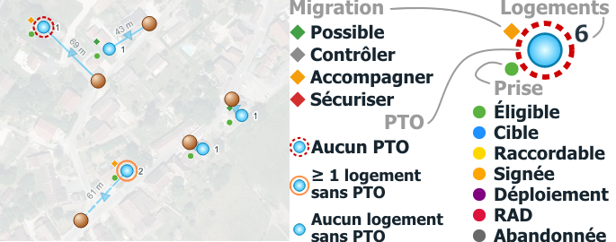
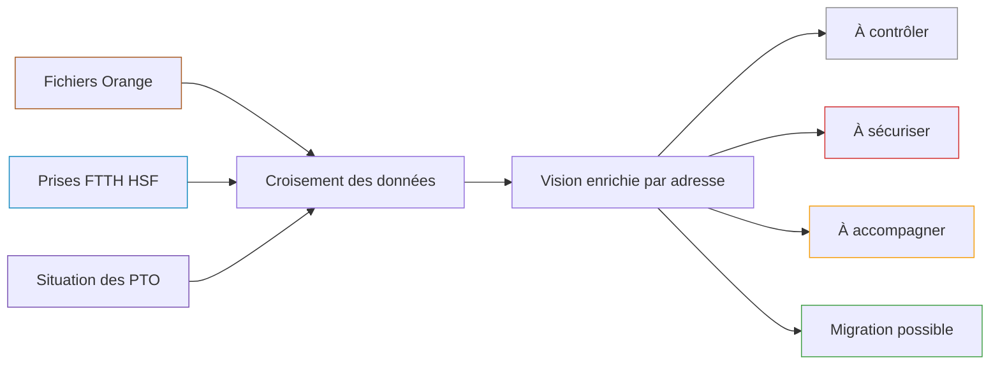
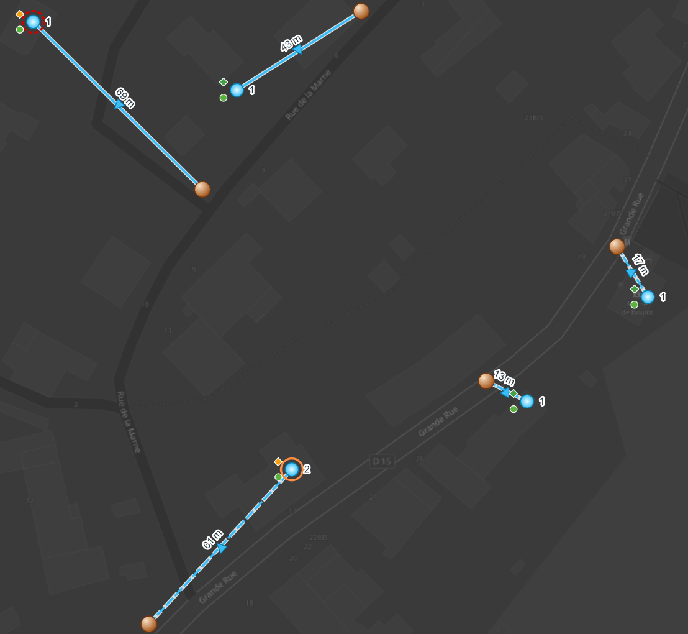
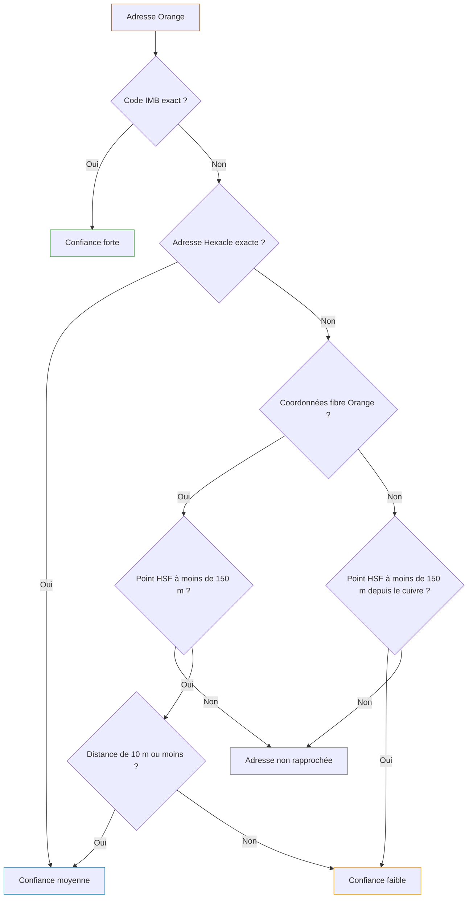
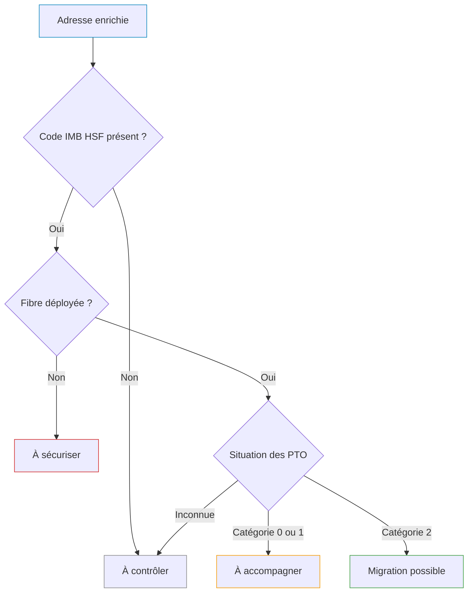
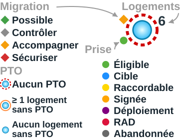
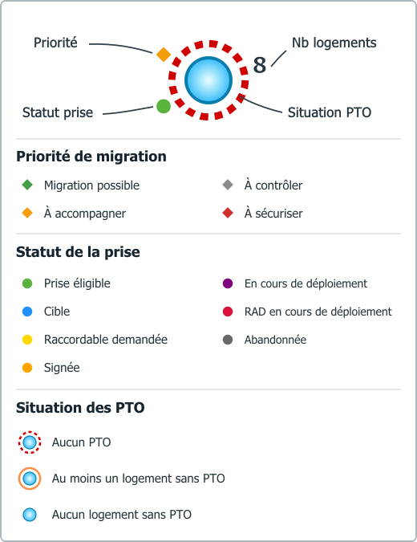
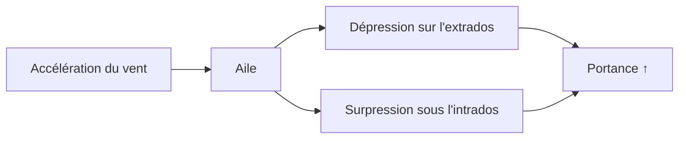
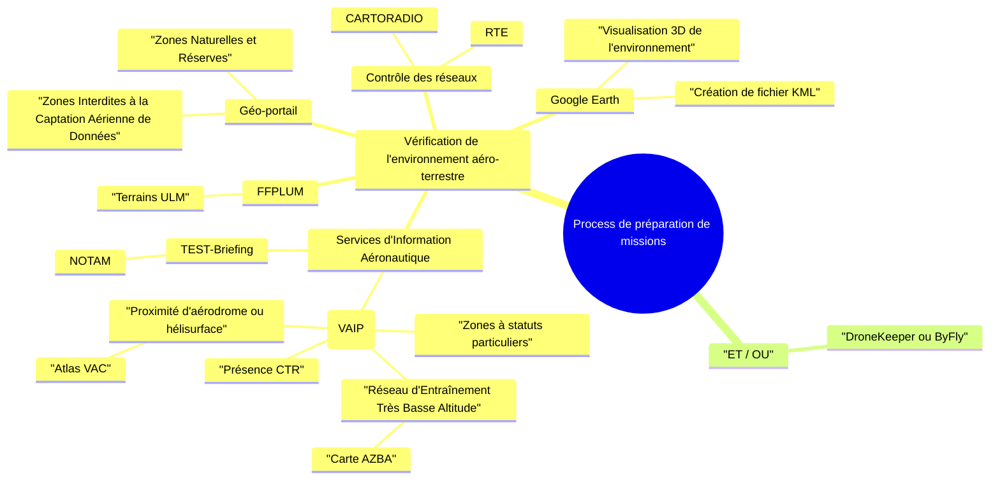

# portable.md Editor draft

Text above the first portable.md header is preserved but not rendered by portable.md.
<!--pmd
id:"home"
title:"Home"
kind:"home"
tags:"start"
updated:"2026-10-28"
-->
# Accueil

Ceci est un projet de test pour commencer à faire une base de connaissance tout en testant l'outil.  

> [!TIP]
> Ce document comporte plusieurs pages, exemples :  
> [Analyse Cuivre - Fibre](#/technique/sig/analyse_cuivre_fibre)  
> [Suivi MT Voirie](#/communication/suivi_mt_voirie)
<!--pmd
id:"technique"
title:"Technique"
kind:"simple"
parent:"home"
updated:"2026-10-28"
-->

<!--pmd
id:"sig"
title:"SIG"
parent:"technique"
updated:"2026-10-28"
-->
# SIG

Start writing here.
<!--pmd
id:"analyse_cuivre_fibre"
title:"Analyse Cuivre - Fibre"
parent:"sig"
updated:"2026-10-28" "Erwan"
-->

# Analyse des accès cuivre actifs et de leur situation fibre

==Localisation du projet==
```txt
\\cg70.intra\hsn\technique HSN\500_SIG\030_FME\015_analyse_cuivre_fibre_orange_hsf
```

## 1. Objectif du projet

Ce projet vise à localiser les adresses disposant encore d'au moins un accès cuivre actif, à les rapprocher des données fibre disponibles, puis à qualifier leur niveau de préparation à la migration vers la fibre.

Test

Le résultat constitue une aide à l'analyse pour HSN, HSF et les collectivités. Il doit permettre de distinguer rapidement :

- les adresses pour lesquelles la migration paraît possible ;
- les adresses où un équipement PTO reste à vérifier ou à réaliser ;
- les adresses dont la situation fibre doit être contrôlée ;
- les adresses dont le déploiement fibre n'est pas encore terminé et qui doivent être sécurisées avant la fermeture du cuivre.

Cette analyse ne prouve ni l'existence d'un abonnement fibre actif, ni l'absence d'un abonnement fibre. Elle croise des données d'infrastructure et des adresses disposant encore d'un accès cuivre actif. Le raccordement réel d'un logement et la souscription de l'occupant restent deux notions distinctes.

:::info Lecture rapide
La couche principale associe une adresse cuivre Orange à l’adresse fibre HSF jugée la plus pertinente. Les symboles indiquent ensuite la priorité de migration, le statut fibre, la situation des PTO et le nombre de logements.
:::

### Lire rapidement la carte

| Symbole | Signification |
|---|---|
| :point_cuivre_orange: | Adresse disposant encore d’au moins un accès cuivre actif |
| :point_fibre_orange: | Position fibre transmise par Orange, lorsqu’elle est exploitable |
| :point_fibre_hsf: | Adresse ou immeuble fibre HSF retenu par le rapprochement |
| :lien_orange_categorie_1: | Déplacement entre les coordonnées cuivre et fibre Orange |
| :lien_hsf_confiance_forte: | Lien entre l’adresse cuivre et le point HSF retenu |



#### Exemple vidéo
:::figure Parcours utilisateur de l'analyse 

:::

## 2. Données utilisées

| Source | Emplacement | Contenu utile | Rôle dans l'analyse |
|---|---|---|---|
| Fichiers mensuels Orange | `in/adresses_actives_*.xlsx` | Adresse cuivre, accès cuivre actifs, coordonnées cuivre, éventuelles coordonnées fibre Orange, codes IMB et Hexacle, opérateur, distance et indice de confiance Orange | Point de départ de l'analyse et localisation des accès cuivre actifs |
| Prises FTTH HSF | Base `hsn_fibre.prises_ftth` | Adresse et coordonnées de l'immeuble, état du déploiement, nombre de logements, informations du point de mutualisation | Référence fibre HSF et qualification de l'éligibilité |
| Situation des PTO HSF | Base `hsn_fibre.imb_sans_pto` | Catégorie PTO agrégée par immeuble, nombre de logements et coordonnées | Qualification de la situation des PTO |

Les fichiers `out/prises.parquet` et `out/pto.parquet` sont des extractions techniques des deux sources HSF. Ils facilitent les contrôles, mais FME lit les tables HSF directement en base.

<center>

:::figure Sources mobilisées et résultats de l’analyse {#flux-donnees}



:::

</center>

### État du jeu de travail actuel

| Élément | Nombre d'entités |
|---|---:|
| Adresses cuivre analysées | 66 |
| Références fibre Orange disposant de coordonnées | 63 |
| Références fibre HSF rapprochées | 66 |
| Lignes cuivre vers fibre Orange | 63 |
| Lignes cuivre vers fibre HSF | 66 |

Ces nombres correspondent à l'export de travail actuel et évolueront avec les mises à jour mensuelles.

Point d'attention : 14 classeurs sont présents dans `in`, mais le workspace FME en référence actuellement 13. `adresses_actives_vregille.xlsx` n'est pas inclus dans la sélection FME actuelle.

## 3. Couches produites

| Visuel | Couche publiée | Table PostGIS | Export de contrôle | Géométrie | Usage et rendu |
|---|---|---|---|---|---|
| :point_cuivre_orange: | Points cuivre Orange | `hsn_fibre.analyse_cuivre_pt_cuivre` | `out/pt_cuivre_orange.parquet` | Point | Position de l'accès cuivre actif, symbole cuivre brillant, une fiche d'information |
| :point_fibre_orange: | Optionnel - Données fibre | `hsn_fibre.analyse_cuivre_pt_fibre_orange` | `out/pt_cuivre_fibre_orange.parquet` | Point | Position fibre transmise par Orange, symbole orange brillant, une fiche d'information |
| :point_fibre_hsf: | Analyse cuivre Orange - fibre HSF | `hsn_fibre.analyse_cuivre_pt_fibre_hsf` | `out/pt_cuivre_fibre_hsf.parquet` | Point | Couche principale enrichie, symbole bleu, indicateurs de priorité, de statut fibre, de PTO et nombre de logements |
| :lien_orange_categorie_1: | Optionnel - Distance fibre Orange | `hsn_fibre.analyse_cuivre_distance_fibre_orange` | `out/distance_cuivre_fibre_orange.parquet` | Ligne | Comparaison entre le point cuivre et la position fibre Orange, ligne orange avec distance |
| :lien_hsf_confiance_forte: | Distance cuivre Orange - fibre HSF | `hsn_fibre.analyse_cuivre_distance_fibre_hsf` | `out/distance_cuivre_fibre_hsf.parquet` | Ligne | Lien entre le point cuivre et le point HSF retenu, ligne bleu clair avec distance et niveau de confiance |

Les lignes sont des objets d'analyse. Elles représentent un déplacement géographique entre deux coordonnées, pas le tracé réel d'un réseau ni un itinéraire de raccordement.

:::figure Aperçu des points et des liens à l’échelle locale {#apercu-couches}
<center></center>
:::


## 4. Chaîne de traitement

### 4.1 Préparation

1. Les fichiers Orange sont regroupés et chaque ligne reçoit un identifiant `hsn_id_adresse`.
2. Les coordonnées Orange sont transformées en points.
3. Les comparaisons de distance sont réalisées en projection métrique EPSG:2154.
4. Les données HSF `prises_ftth` et `imb_sans_pto` sont préparées pour les rapprochements.

### 4.2 Hiérarchie de rapprochement avec HSF

Le premier rapprochement réussi est conservé.

<center>



</center>

| Ordre | Méthode | Règle | Confiance HSN |
|---:|---|---|---|
| 1 | Code IMB | Correspondance exacte entre le code IMB Orange et le code IMB HSF | Forte |
| 2 | Code adresse Hexacle | Correspondance exacte entre la clé d'adresse Orange et la clé d'adresse HSF | Moyenne |
| 3 | Proximité sur coordonnées fibre Orange | Immeuble HSF le plus proche dans le même code INSEE, à 150 m maximum | Moyenne jusqu'à 10 m, faible au-delà |
| 4 | Proximité sur coordonnées cuivre | Utilisée lorsque les coordonnées fibre Orange sont absentes ; immeuble HSF le plus proche dans le même code INSEE, à 150 m maximum | Faible |

Le rapprochement géographique retient un seul candidat, le plus proche. La limite à la même commune INSEE réduit le risque de rattacher une adresse à un immeuble situé dans une commune voisine.

Répartition actuelle :

| Méthode | Nombre d'adresses |
|---|---:|
| Code IMB | 31 |
| Code adresse Hexacle | 17 |
| Proximité sur coordonnées fibre Orange | 15 |
| Proximité sur coordonnées cuivre | 3 |

### 4.3 Enrichissement et publication

Après le rapprochement, FME :

1. ajoute les informations de l'immeuble et du point de mutualisation HSF ;
2. recherche la situation PTO associée au code IMB ;
3. calcule les champs d'analyse préfixés `hsn_` ;
4. construit les trois couches de points et les deux couches de lignes ;
5. calcule la longueur des lignes en mètres ;
6. publie les tables PostGIS utilisées par Mon Territoire Carto.

## 5. Transparence algorithmique et rendu final

### 5.1 Source de référence du rapprochement

Le champ `hsn_source_reference` indique le point Orange utilisé pour la recherche par proximité.

| Valeur | Signification | Effectif actuel |
|---|---|---:|
| `fibre Orange` | Les coordonnées fibre fournies par Orange ont servi de référence | 63 |
| `cuivre` | Les coordonnées fibre Orange étaient absentes ; les coordonnées cuivre ont servi de référence | 3 |

Cette valeur est informative dans la fiche de la couche HSF. Elle ne modifie pas directement le symbole ponctuel, mais intervient dans le calcul de la confiance.

### 5.2 Méthode et confiance du rapprochement HSN

Le champ `hsn_methode_rapprochement` décrit la méthode. Le champ `hsn_confiance_rapprochement` traduit sa robustesse pour le rendu de la ligne HSF.

| Visuel | Confiance | Cas concernés | Effectif actuel | Rendu de la ligne HSF |
|---|---|---|---:|---|
| :lien_hsf_confiance_forte: | `forte` | Correspondance exacte par code IMB | 31 | Ligne bleu clair continue |
| :lien_hsf_confiance_moyenne: | `moyenne` | Correspondance exacte par Hexacle ou proximité depuis la fibre Orange à 10 m maximum | 31 | Ligne bleu clair en tirets |
| :lien_hsf_confiance_faible: | `faible` | Proximité depuis la fibre Orange au-delà de 10 m ou depuis le point cuivre | 4 | Ligne bleu clair en pointillés |

Une confiance faible ne signifie pas que le rapprochement est faux. Elle signifie qu'il doit être vérifié plus attentivement.

### 5.3 Indice de confiance Orange

Le champ `orange_confiance_rapprochement` provient directement des fichiers Orange. Il est distinct de la confiance HSN décrite ci-dessus.

| Visuel | Valeur visible dans la couche de ligne Orange | Interprétation cartographique | Rendu |
|---|---|---|---|
| :lien_orange_categorie_1: | `Categorie 1` | Confiance Orange la plus élevée parmi les points fibre Orange représentés | Ligne orange continue |
| :lien_orange_categorie_2: | `Categorie 2` | Confiance Orange plus faible | Ligne orange en tirets |

Les critères détaillés qui distinguent les catégories Orange ne sont pas recalculés par HSN et doivent être confirmés dans la documentation du fournisseur. Les catégories 3 et 4 peuvent rester présentes dans les attributs de la couche HSF, notamment lorsque la position fibre Orange n'est pas exploitable pour créer le point Orange.

### 5.4 Éligibilité fibre synthétique

Le champ `hsn_fibre_eligible` est calculé à partir de `hsf_statut_fibre`.

| Condition | Valeur produite | Effet final |
|---|---|---|
| `hsf_statut_fibre = DEPLOYE` | `Oui` | L'adresse est considérée comme éligible dans l'analyse |
| Toute autre situation | Champ non renseigné | Le statut détaillé HSF et la priorité doivent être consultés |

Le traitement ne produit pas actuellement de valeur explicite `Non`. Une valeur vide ne doit donc pas être interprétée seule comme une non-éligibilité certaine.

Dans le jeu actuel, les 66 adresses rapprochées ont la valeur `Oui`.

### 5.5 Statut fibre affiché comme « statut de la prise »

Le petit cercle placé en bas à gauche du point HSF utilise le champ `hsf_statut_fibre`, issu de l'état d'immeuble HSF.

| Visuel | Valeur HSF | Libellé cartographique | Couleur |
|---|---|---|---|
| :statut_eligible: | `DEPLOYE` | Éligible | Vert |
| :statut_cible: | `CIBLE` | Cible | Bleu |
| :statut_raccordable_demandee: | `RACCORDABLE DEMANDE` | Raccordable demandée | Jaune |
| :statut_signee: | `SIGNE` | Signée | Orange |
| :statut_en_cours_de_deploiement: | `EN COURS DE DEPLOIEMENT` | En cours de déploiement | Violet |
| :statut_rad_en_cours_de_deploiement: | `RAD EN COURS DE DEPLOIEMENT` | RAD en cours de déploiement | Rouge |
| :statut_abandonnee: | `ABANDONNE` | Abandonnée | Gris |

Le libellé visuel « statut de la prise » est simplifié. Techniquement, le champ décrit l'état fibre de l'immeuble ou de l'adresse HSF, pas l'état contractuel d'une prise chez un occupant.

### 5.6 Situation des PTO

Le champ source `hsf_pto_categorie` est traduit dans `hsn_situation_pto`.

| Visuel | Catégorie HSF | Valeur HSN | Sens métier | Rendu autour du point HSF |
|---|---|---|---|---|
| :pto_aucun: | `0 - IMB sans PTO` | `Aucun PTO` | Aucun PTO connu dans l'immeuble | Contour rouge discontinu |
| :pto_au_moins_un_logement_sans: | `1 - IMB avec au moins 1 logement sans PTO` | `Au moins un logement sans PTO` | L'immeuble comporte au moins un logement sans PTO | Contour orange continu |
| :pto_aucun_logement_sans: | `2 - IMB sans logement sans PTO` | `Aucun logement sans PTO` | Aucun logement n'est identifié comme restant sans PTO | Pas de contour supplémentaire |
| :pto_inconnu: | `PTO_inconnu` | `Inconnue` | Aucune situation PTO n'a pu être associée | Pas de contour spécifique et priorité à contrôler |

Cette information porte sur la présence connue d'un PTO. Elle ne prouve pas qu'un abonnement fibre est actif.

Répartition actuelle : 37 adresses sans PTO, 4 avec au moins un logement sans PTO, 24 sans logement restant sans PTO et 1 situation inconnue.

### 5.7 Priorité de migration

Le champ `hsn_priorite_migration` applique les règles suivantes dans l'ordre.  

<center>



</center>

La première règle satisfaite est retenue.

| Visuel | Ordre | Condition | Classe | Rendu sur le point HSF | Effectif actuel |
|---|---:|---|---|---|---:|
| :priorite_a_controler: | 1 | Aucun code IMB HSF rapproché | `À contrôler` | Losange gris en haut à gauche | 0 |
| :priorite_a_securiser: | 2 | Statut fibre HSF différent de `DEPLOYE` | `À sécuriser` | Losange rouge en haut à gauche | 0 |
| :priorite_a_accompagner: | 3 | Catégorie PTO 0 ou 1 | `À accompagner` | Losange orange en haut à gauche | 41 |
| :priorite_migration_possible: | 4 | Catégorie PTO 2 | `Migration possible` | Losange vert en haut à gauche | 24 |
| :priorite_a_controler: | 5 | Situation PTO inconnue | `À contrôler` | Losange gris en haut à gauche | 1 |

La classe est une aide à la priorisation. Elle ne remplace pas une vérification terrain ou une instruction opérationnelle du raccordement.

### 5.8 Distances

Deux notions de distance sont conservées :

| Champ | Calcul | Usage |
|---|---|---|
| `hsn_distance_rapprochement_m` | Distance entre le point de référence Orange retenu et le candidat HSF | Contrôle de la qualité du rapprochement HSF |
| `hsn_distance_cuivre_fibre_m` | Longueur de la ligne entre le point cuivre et le point fibre représenté | Étiquette cartographique en mètres sur les couches de lignes |
| `orange_distance_cuivre_fibre_m` | Distance fournie par Orange entre ses positions cuivre et fibre | Information de comparaison dans les fiches |

Les couches de lignes et leurs étiquettes sont limitées aux échelles locales, jusqu'au 1:25 000, pour éviter de surcharger la carte.

### 5.9 Composition du symbole HSF

Le symbole principal rassemble quatre informations sans modifier la position du point :

- :point_fibre_hsf: point central bleu : position de l'immeuble HSF retenu ;
- :priorite_a_accompagner: losange en haut à gauche : priorité de migration ;
- :statut_eligible: cercle en bas à gauche : statut fibre HSF ;
- :pto_aucun: contour autour du point : situation des PTO ;
- nombre placé à droite : nombre de logements HSF.

<center>

:::figure Légende complète du symbole HSF {#legende-symbole-hsf}
 
:::

</center>


### 5.10 Organisation des fiches de consultation

Les champs suivent le même ordre fonctionnel dans toutes les fiches : résultat métier, adresse, rapprochement, informations techniques, coordonnées, identifiants, puis traçabilité. Les champs techniques de la plateforme (`sogefi_identifiant`, `id_sogefi`, `insee`, `geom` et `geom_label`) restent masqués.

Les deux couches de lignes n’ont pas de fiche de consultation. Leur distance et leur confiance sont déjà portées par la carte.

:::spoiler Points cuivre Orange · onglet « Accès cuivre Orange »

| Nom du champ | Libellé utilisateur |
|---|---|
| `hsn_priorite_migration` | Priorité de migration |
| `hsn_fibre_eligible` | Éligibilité à la fibre |
| `hsn_situation_pto` | Situation des PTO |
| `orange_numero_cuivre` | Numéro de voie |
| `orange_voie_cuivre` | Voie |
| `orange_commune` | Commune |
| `orange_code_insee` | Code INSEE |
| `orange_nb_acces_cuivre` | Nombre d’accès cuivre actifs |
| `orange_cuivre_x` | Coordonnée cuivre X |
| `orange_cuivre_y` | Coordonnée cuivre Y |
| `orange_cle_imb` | Code IMB Orange |
| `hsf_cle_imb` | Code IMB HSF correspondant |
| `orange_cle_adresse` | Clé d’adresse Orange |
| `hsf_cle_adresse` | Clé d’adresse HSF correspondante |
| `orange_code_rivoli` | Code RIVOLI |
| `orange_hexacle_voie` | Code Hexacle de la voie |
| `hsn_id_adresse` | Identifiant de l’analyse |

:::

:::spoiler Analyse cuivre Orange - fibre HSF · onglet « Analyse HSN »

| Nom du champ | Libellé utilisateur |
|---|---|
| `hsn_priorite_migration` | Priorité de migration |
| `hsn_fibre_eligible` | Éligibilité à la fibre |
| `hsn_situation_pto` | Situation des PTO |
| `hsn_confiance_rapprochement` | Confiance du rapprochement |
| `hsn_methode_rapprochement` | Méthode de rapprochement |
| `hsn_distance_rapprochement_m` | Distance du rapprochement (m) |
| `hsn_source_reference` | Point utilisé pour le rapprochement |
| `hsn_id_adresse` | Identifiant de l’analyse |

:::

:::spoiler Analyse cuivre Orange - fibre HSF · onglet « Données HSF »

| Nom du champ | Libellé utilisateur |
|---|---|
| `hsf_statut_fibre` | Statut de la fibre |
| `hsf_pto_categorie` | Situation détaillée des PTO |
| `hsf_pto_statut_immeuble` | Statut de l’immeuble dans la source PTO |
| `hsf_numero_voie_immeuble` | Numéro de voie |
| `hsf_type_voie_immeuble` | Type de voie |
| `hsf_nom_voie_immeuble` | Nom de la voie |
| `hsf_batiment_immeuble` | Bâtiment ou complément |
| `hsf_code_postal_immeuble` | Code postal |
| `hsf_commune_immeuble` | Commune |
| `hsf_code_insee_immeuble` | Code INSEE de l’immeuble |
| `hsf_type_immeuble` | Type de local |
| `hsf_nb_logements` | Nombre de logements |
| `hsf_nb_logements_pro` | Nombre de locaux professionnels |
| `hsf_pto_nb_logements` | Nombre de logements dans la source PTO |
| `hsf_immeuble_neuf` | Immeuble neuf |
| `hsf_type_zone` | Zone de déploiement fibre |
| `hsf_date_cablage_adresse` | Date de câblage de l’adresse |
| `hsf_date_service_immeuble` | Date de mise en service commerciale |
| `hsf_emplacement_actif_disponible` | Emplacement actif disponible |
| `hsf_fibre_dediee_libre` | Fibre dédiée disponible |
| `hsf_accord_gestionnaire_requis` | Accord du gestionnaire requis |
| `hsf_numero_voie_gestionnaire` | Numéro de voie déclaré par le gestionnaire |
| `hsf_type_ingenierie` | Type d’ingénierie fibre |
| `hsf_etat_pm` | État du point de mutualisation |
| `hsf_type_emplacement_pm` | Emplacement du point de mutualisation |
| `hsf_capacite_max_pm` | Capacité maximale du point de mutualisation |
| `hsf_nb_logements_pm` | Nombre de logements rattachés au point de mutualisation |
| `hsf_brassage_pm_oi` | Brassage entre le PM et l’opérateur d’immeuble |
| `hsf_type_voie_pm` | Type de voie du point de mutualisation |
| `hsf_nom_voie_pm` | Voie du point de mutualisation |
| `hsf_code_postal_pm` | Code postal du point de mutualisation |
| `hsf_commune_pm` | Commune du point de mutualisation |
| `hsf_qualite_adresse_pm` | Qualité de l’adresse du point de mutualisation |
| `hsf_projection` | Système de coordonnées HSF |
| `hsf_immeuble_x` | Coordonnée immeuble X |
| `hsf_immeuble_y` | Coordonnée immeuble Y |
| `hsf_pm_x` | Coordonnée du point de mutualisation X |
| `hsf_pm_y` | Coordonnée du point de mutualisation Y |
| `hsf_cle_imb` | Code IMB HSF |
| `hsf_cle_adresse` | Clé d’adresse HSF |
| `hsf_code_insee` | Code INSEE HSF |
| `hsf_code_rivoli_immeuble` | Code RIVOLI de l’immeuble |
| `hsf_code_hexacle_voie` | Code Hexacle de la voie |
| `hsf_reference_pm` | Référence du point de mutualisation |
| `hsf_code_adresse_pm` | Code adresse du point de mutualisation |
| `hsf_code_insee_pm` | Code INSEE du point de mutualisation |
| `hsf_code_rivoli_pm` | Code RIVOLI du point de mutualisation |
| `hsf_reference_consultation_native` | Référence native de consultation |
| `hsf_reference_consultation` | Référence de consultation |
| `hsf_date_installation_pm` | Date d’installation du point de mutualisation |
| `hsf_date_service_pm` | Date de mise en service du point de mutualisation |
| `hsf_date_premiere_mad_pm` | Première mise à disposition du point de mutualisation |
| `hsf_pto_date_maj` | Mise à jour des données PTO |
| `hsf_date_maj` | Mise à jour des données HSF |
| `hsf_date_derniere_modification` | Dernière modification de l’enregistrement HSF |

:::

:::spoiler Analyse cuivre Orange - fibre HSF · onglet « Données Orange »

| Nom du champ | Libellé utilisateur |
|---|---|
| `orange_numero_fibre` | Numéro de l’adresse fibre |
| `orange_voie_fibre` | Voie de l’adresse fibre |
| `orange_commune` | Commune |
| `orange_code_insee` | Code INSEE |
| `orange_numero_cuivre` | Numéro de l’adresse cuivre |
| `orange_voie_cuivre` | Voie de l’adresse cuivre |
| `orange_confiance_rapprochement` | Confiance du rapprochement Orange |
| `orange_distance_cuivre_fibre_m` | Distance cuivre vers fibre Orange (m) |
| `orange_operateur_fibre` | Opérateur d’infrastructure fibre |
| `orange_nb_acces_cuivre` | Nombre d’accès cuivre actifs |
| `orange_fibre_x` | Coordonnée fibre Orange X |
| `orange_fibre_y` | Coordonnée fibre Orange Y |
| `orange_cuivre_x` | Coordonnée cuivre X |
| `orange_cuivre_y` | Coordonnée cuivre Y |
| `orange_cle_imb` | Code IMB Orange |
| `orange_cle_adresse` | Clé d’adresse Orange |
| `orange_code_rivoli` | Code RIVOLI |
| `orange_hexacle_voie` | Code Hexacle de la voie |

:::

:::spoiler Données fibre Orange · onglet unique

| Nom du champ | Libellé utilisateur |
|---|---|
| `hsn_priorite_migration` | Priorité de migration |
| `hsn_fibre_eligible` | Éligibilité à la fibre |
| `hsn_situation_pto` | Situation des PTO |
| `orange_numero_fibre` | Numéro de l’adresse fibre |
| `orange_voie_fibre` | Voie de l’adresse fibre |
| `orange_commune` | Commune |
| `orange_code_insee` | Code INSEE |
| `orange_numero_cuivre` | Numéro de l’adresse cuivre |
| `orange_voie_cuivre` | Voie de l’adresse cuivre |
| `orange_confiance_rapprochement` | Confiance du rapprochement Orange |
| `orange_distance_cuivre_fibre_m` | Distance cuivre vers fibre Orange (m) |
| `orange_operateur_fibre` | Opérateur d’infrastructure fibre |
| `orange_nb_acces_cuivre` | Nombre d’accès cuivre actifs |
| `orange_fibre_x` | Coordonnée fibre Orange X |
| `orange_fibre_y` | Coordonnée fibre Orange Y |
| `orange_cuivre_x` | Coordonnée cuivre X |
| `orange_cuivre_y` | Coordonnée cuivre Y |
| `orange_cle_imb` | Code IMB Orange |
| `hsf_cle_imb` | Code IMB HSF correspondant |
| `orange_cle_adresse` | Clé d’adresse Orange |
| `hsf_cle_adresse` | Clé d’adresse HSF correspondante |
| `orange_code_rivoli` | Code RIVOLI |
| `orange_hexacle_voie` | Code Hexacle de la voie |
| `hsn_id_adresse` | Identifiant de l’analyse |

:::

:::figure Nommage des champs de l'analyse cuivre sur Aramis

:::

## 6. Convention de nommage des champs

| Préfixe | Origine | Interprétation |
|---|---|---|
| `hsn_` | HSN | Champ calculé ou normalisé par le traitement FME |
| `hsf_` | HSF | Champ repris des données fibre ou PTO HSF |
| `orange_` | Orange | Champ repris des fichiers mensuels Orange |
| sans préfixe | Plateforme | Champ technique de stockage ou de publication |

## 7. Traduction des champs communs

### 7.1 Champs d'analyse HSN

| Nom technique | Libellé naturel | Définition |
|---|---|---|
| `hsn_id_adresse` | Identifiant de l'adresse analysée | Identifiant attribué à la ligne Orange pendant le traitement |
| `hsn_priorite_migration` | Priorité de migration | Classe synthétique : migration possible, à accompagner, à contrôler ou à sécuriser |
| `hsn_fibre_eligible` | Fibre éligible | Indique `Oui` lorsque le statut HSF est `DEPLOYE` |
| `hsn_situation_pto` | Situation des PTO | Traduction simplifiée de la catégorie PTO HSF |
| `hsn_source_reference` | Coordonnée utilisée pour le rapprochement | Indique si la proximité a été calculée depuis le point fibre Orange ou le point cuivre |
| `hsn_methode_rapprochement` | Méthode de rapprochement HSF | Code IMB, adresse Hexacle ou proximité géographique |
| `hsn_confiance_rapprochement` | Confiance du rapprochement HSF | Forte, moyenne ou faible |
| `hsn_distance_rapprochement_m` | Distance de rapprochement HSF en mètres | Distance entre la coordonnée de référence et le point HSF retenu |
| `hsn_distance_cuivre_fibre_m` | Distance cuivre vers fibre en mètres | Longueur calculée de la ligne cartographique |
| `hsn_timestamp` | Date et heure du traitement | Horodatage de génération de la donnée publiée |

### 7.2 Champs Orange

| Nom technique | Libellé naturel | Groupe |
|---|---|---|
| `orange_cle_adresse` | Clé d'adresse Orange | Identifiants |
| `orange_cle_imb` | Code IMB indiqué par Orange | Identifiants |
| `orange_code_insee` | Code INSEE Orange | Adresse |
| `orange_commune` | Commune Orange | Adresse |
| `orange_numero_cuivre` | Numéro de voie de l'accès cuivre | Cuivre |
| `orange_voie_cuivre` | Voie de l'accès cuivre | Cuivre |
| `orange_code_rivoli` | Code RIVOLI de la voie | Cuivre |
| `orange_hexacle_voie` | Code Hexacle de la voie | Cuivre |
| `orange_nb_acces_cuivre` | Nombre d'accès cuivre actifs | Cuivre |
| `orange_cuivre_x` | Coordonnée X de l'accès cuivre | Cuivre |
| `orange_cuivre_y` | Coordonnée Y de l'accès cuivre | Cuivre |
| `orange_numero_fibre` | Numéro de voie de l'adresse fibre Orange | Fibre Orange |
| `orange_voie_fibre` | Voie de l'adresse fibre Orange | Fibre Orange |
| `orange_operateur_fibre` | Opérateur d'infrastructure fibre indiqué par Orange | Fibre Orange |
| `orange_fibre_x` | Coordonnée X de l'accès fibre Orange | Fibre Orange |
| `orange_fibre_y` | Coordonnée Y de l'accès fibre Orange | Fibre Orange |
| `orange_confiance_rapprochement` | Indice de confiance Orange | Fibre Orange |
| `orange_distance_cuivre_fibre_m` | Distance cuivre vers fibre fournie par Orange | Fibre Orange |

## 8. Traduction des champs spécifiques HSF

### 8.1 Immeuble et adresse fibre

| Nom technique | Libellé naturel |
|---|---|
| `hsf_cle_imb` | Code IMB HSF |
| `hsf_cle_adresse` | Clé d'adresse HSF |
| `hsf_code_insee` | Code INSEE HSF de rattachement |
| `hsf_code_insee_immeuble` | Code INSEE de l'immeuble |
| `hsf_commune_immeuble` | Commune de l'immeuble |
| `hsf_code_postal_immeuble` | Code postal de l'immeuble |
| `hsf_numero_voie_immeuble` | Numéro de voie de l'immeuble |
| `hsf_type_voie_immeuble` | Type de voie de l'immeuble |
| `hsf_nom_voie_immeuble` | Nom de voie de l'immeuble |
| `hsf_batiment_immeuble` | Complément ou bâtiment de l'immeuble |
| `hsf_code_rivoli_immeuble` | Code RIVOLI de l'immeuble |
| `hsf_code_hexacle_voie` | Code Hexacle de la voie HSF |
| `hsf_type_immeuble` | Type de local : immeuble ou pavillon |
| `hsf_nb_logements` | Nombre de logements à l'adresse |
| `hsf_nb_logements_pro` | Nombre de logements professionnels |
| `hsf_immeuble_neuf` | Indicateur d'immeuble neuf |
| `hsf_type_zone` | Code du type de zone fibre |
| `hsf_statut_fibre` | État du déploiement fibre de l'immeuble |
| `hsf_date_cablage_adresse` | Date de câblage de l'adresse |
| `hsf_date_service_immeuble` | Date de mise en service commerciale de l'immeuble |
| `hsf_emplacement_actif_disponible` | Présence d'un emplacement actif disponible |
| `hsf_fibre_dediee_libre` | Présence d'une fibre dédiée libre |
| `hsf_accord_gestionnaire_requis` | Accord du gestionnaire d'immeuble requis |
| `hsf_numero_voie_gestionnaire` | Numéro de voie déclaré par le gestionnaire |
| `hsf_type_ingenierie` | Type d'ingénierie fibre |
| `hsf_projection` | Système de projection déclaré par HSF |
| `hsf_immeuble_x` | Coordonnée X de l'immeuble HSF |
| `hsf_immeuble_y` | Coordonnée Y de l'immeuble HSF |

### 8.2 Situation des PTO

| Nom technique | Libellé naturel |
|---|---|
| `hsf_pto_statut_immeuble` | Statut fibre de l'immeuble dans la source PTO |
| `hsf_pto_categorie` | Catégorie de présence ou d'absence de PTO |
| `hsf_pto_nb_logements` | Nombre de logements associé à la situation PTO |
| `hsf_pto_date_maj` | Date de mise à jour de la situation PTO |

### 8.3 Point de mutualisation

| Nom technique | Libellé naturel |
|---|---|
| `hsf_reference_pm` | Référence du point de mutualisation |
| `hsf_etat_pm` | État du point de mutualisation |
| `hsf_type_emplacement_pm` | Type d'emplacement du point de mutualisation |
| `hsf_capacite_max_pm` | Capacité maximale du point de mutualisation |
| `hsf_nb_logements_pm` | Nombre de logements rattachés au point de mutualisation |
| `hsf_date_installation_pm` | Date d'installation du point de mutualisation |
| `hsf_date_service_pm` | Date de mise en service commerciale du point de mutualisation |
| `hsf_date_premiere_mad_pm` | Date de première mise à disposition du point de mutualisation |
| `hsf_brassage_pm_oi` | Indicateur de brassage entre le PM et l'opérateur d'immeuble |
| `hsf_code_adresse_pm` | Code adresse du point de mutualisation |
| `hsf_code_insee_pm` | Code INSEE du point de mutualisation |
| `hsf_commune_pm` | Commune du point de mutualisation |
| `hsf_code_postal_pm` | Code postal du point de mutualisation |
| `hsf_type_voie_pm` | Type de voie du point de mutualisation |
| `hsf_nom_voie_pm` | Nom de voie du point de mutualisation |
| `hsf_code_rivoli_pm` | Code RIVOLI du point de mutualisation |
| `hsf_qualite_adresse_pm` | Qualité de l'adresse du point de mutualisation |
| `hsf_pm_x` | Coordonnée X du point de mutualisation |
| `hsf_pm_y` | Coordonnée Y du point de mutualisation |
| `hsf_reference_consultation_native` | Référence native de consultation |
| `hsf_reference_consultation` | Référence complète de consultation |
| `hsf_date_maj` | Date de mise à jour du jeu de données HSF |
| `hsf_date_derniere_modification` | Date de dernière modification de l'enregistrement HSF |

## 9. Champs techniques communs aux tables publiées

| Nom technique | Libellé naturel | Usage |
|---|---|---|
| `sogefi_identifiant` | Identifiant technique Sogefi | Gestion interne de la plateforme |
| `insee` | Code INSEE de publication | Indexation et filtrage territorial |
| `id_sogefi` | Identifiant interne de l'entité | Clé technique de la table |
| `geom_label` | Géométrie ou information technique d'étiquette | Fonctionnement interne de la plateforme |
| `geom` | Géométrie cartographique | Position du point ou tracé de la ligne |

Ces champs ne portent pas directement une information métier sur la migration cuivre vers fibre.

## 10. Répartition des champs par couche

### 10.1 Points cuivre Orange

Champs communs d'analyse : `hsn_id_adresse`, `hsn_priorite_migration`, `hsn_fibre_eligible`, `hsn_situation_pto`.

Champs d'identification : `hsf_cle_imb`, `hsf_cle_adresse`, `orange_cle_adresse`, `orange_cle_imb`.

Champs propres à la position cuivre Orange : `orange_code_insee`, `orange_commune`, `orange_numero_cuivre`, `orange_voie_cuivre`, `orange_code_rivoli`, `orange_hexacle_voie`, `orange_nb_acces_cuivre`, `orange_cuivre_x`, `orange_cuivre_y`.

### 10.2 Point fibre Orange

La couche reprend les champs du point cuivre et ajoute : `orange_numero_fibre`, `orange_voie_fibre`, `orange_operateur_fibre`, `orange_fibre_x`, `orange_fibre_y`, `orange_confiance_rapprochement`, `orange_distance_cuivre_fibre_m`.

### 10.3 Point fibre HSF enrichi

La couche principale rassemble :

- tous les champs d'analyse `hsn_` ;
- les identifiants et informations cuivre Orange ;
- les informations fibre Orange disponibles ;
- tous les champs HSF relatifs à l'immeuble, aux PTO et au point de mutualisation.

La fiche est organisée logiquement en trois groupes : analyse HSN, informations HSF et informations Orange.

### 10.4 Ligne cuivre vers fibre Orange

Champs métier : `hsn_id_adresse`, `hsn_priorite_migration`, `orange_cle_imb`, `hsn_distance_cuivre_fibre_m`, `orange_confiance_rapprochement`.

La couche n'a pas vocation à présenter une fiche détaillée. Elle porte la distance et le niveau de confiance nécessaires à son rendu.

### 10.5 Ligne cuivre vers fibre HSF

Champs métier : `hsn_id_adresse`, `hsn_priorite_migration`, `hsf_cle_imb`, `hsn_source_reference`, `hsn_methode_rapprochement`, `hsn_confiance_rapprochement`, `hsn_distance_cuivre_fibre_m`.

La couche n'a pas vocation à présenter une fiche détaillée. Elle explique visuellement le rapprochement retenu.

## 11. Limites d'interprétation

- Les coordonnées peuvent représenter un accès, une adresse ou un immeuble. Elles ne constituent pas systématiquement un relevé terrain précis.
- Une ligne courte ne garantit pas une correspondance correcte si les identifiants sont absents ou erronés.
- Le plus proche voisin est recherché dans un rayon maximal de 150 m et dans le même code INSEE.
- L'état `DEPLOYE` décrit la disponibilité de l'infrastructure dans la source HSF. Il ne garantit pas qu'un occupant a souscrit un abonnement.
- La présence d'un accès cuivre actif peut coexister avec un raccordement ou un abonnement fibre.
- La situation PTO est agrégée à l'échelle de l'immeuble. Elle ne décrit pas individuellement chaque logement.
- Les catégories de confiance Orange sont reprises telles quelles. Leur définition détaillée dépend de la documentation Orange.
- Les classes de priorité sont des indicateurs d'aide à la décision et doivent rester vérifiables dans les trois groupes d'attributs HSN, HSF et Orange.
<!--pmd
id:"drone"
title:"Drones (à remettre au propre)"
parent:"technique"
updated:"2026-10-28"
-->

# Drones (à remettre au propre)

Notes sur les formations drone pour [prepa-drone](https://prepa-drone.fr/cours/)   
Formation Télépilote de drone Spécifique : [Lien Padlet](https://padlet.com/DEC_formation/formation-t-l-pilote-de-drone-sp-cifique-bkv564fxpp54my4j)
Glossaire
## Chapitres

1. [Intro](#/technique/drone/drone_intro)
2. [Préparation de mission](#/technique/drone/drone_prepa_mission)
    - [Exemple de préparation](#/technique/drone/drone_prepa_mission/drone_prepa_mission_ex)
3. [Pilotage](#/technique/drone/drone_pilotage)
4. [Annexes](#/technique/drone/drone_annexes)

## TODO list

- Essayer "Flyby" alternative à Drone Keeper
    - Plus côté aviation : Sofia Briefing
- Achat de drone : ==absolument prendre l'assurance Dji Care==  
    Remplacement dès le premier soucis  
    Même sans assurance, il est toujours possible de les renvoyer et Dji peut les réparer pour une somme modique

<!--pmd
id:"communication"
title:"Communication"
kind:"simple"
parent:"home"
updated:"2026-10-28"
-->

<!--pmd
id:"todolist"
title:"Todolist (à mettre à jour)"
parent:"home"
updated:"2026-10-29"
-->

# Todolist (à mettre à jour)

- ==**1. Mise en service de l’appli SPANC avec intégration de collectivités en autonomie**==

    - Erwan : Flux API, doc SPANC et synchronisation journalière fiabilisés  
    - Audit ergonomie carto : prise en compte ==partielle== des retours 
        - 
        - 
    - Encore des bugs, pas d'historisation des ANC, pas de moyen de supprimer des contrôles, vocabulaire : "Liste des ANC par contrôle" = liste des contrôles.
    -   Pas d'ANC alors que j'ai tous les scopes.
    - France : mise en commun des notes de la CCRC avec Pauline, tests multiples sur les beugs (impossible à refaire), RDV avec CCMC / CCMG début septembre 

- ==2. Mise en service de l’appli Réseaux humides avec intégration de collectivités en autonomie==
        - Point avec Erwan pour ajouter les données de la CAV (en amont du rdv du 3 septembre) prévu le 26/08 à 15h

- ==3. Mise en service de l’appli SIPR avec intégration de collectivités en autonomie==
    - France : en attente du retour de Nicolas (SOGEFI) suite à son retour de congés pour prévoir les temps de formation

- ==4. Finalisation de l’intrication de l’appli « réseaux humides » dans l’environnement ERIDANIS==
    - France : chantier à voir en plusieurs temps, déjà stabiliser la diffusion du module seul (SOGEFI), ensuite mise en place de liens, puis voir l'applicatif comme un ensemble (modifications chez SOGEFI <> ERIDANIS)
    - Erwan : proposition de faire un lien Géoter "alternatif" si l'utilisateur a souscrit aux réseaux humides "Géoter + module réseau humides"
    - Mise en place des liens à étudier en fonction de la réalité logicielle une fois que le module sogefi est maîtrisé.

- ==5. Finalisation de l’intrication de l’appli « SIPR » dans l’environnement ERIDANIS==
    - Erwan : idem que pour les réseaux humides.

- ==6. Mise en place des API quotidiennes pour les cas d’usages IOT + réseaux humides + SIPR entre ERIDANIS et SOGEFI==
    - En attente des accès API (cf. dernier point Eridanis)
    - Le modèle de documentation validé (spanc) ne se retrouve pas dans les autres documentations.

- ==7. Mise en service de l’appli « ADS » avec intégration de collectivités en autonomie==
        - France/Erwan : visio prévu avec les deux agents ADS de la CAV le 25/08 à 14h

- ==8. Elargissement de couches de données sur GEOTER (ARS,…)==
    - France : publication prévue très prochainement, voire pour ajouter les emplacements des captages en +
    - Erwan : chantiers pour étude et intégration de 5+ jeux de données de la DSSP + des instances publiques pour les usagers

- ==9. Accompagnement aux rapprochements des SIG entre HSN et SIED + HSN et SDIS==
    - France/Erwan/Cyril : rdv avec le SIED prévu début septembre, quid pour le SDIS? 

- ==10. Accompagnement du Dépt 70 sur GEOTER==
    - Accompagnements en cours (DSSP), 4 chantiers initiés
        - 1) Mise en place d'une carte interactive contenants multiples données de la DSSP transmises par AS ZBINDEN intégrées par Erwan
        - 2) France : Démonstration prévue le 7 septembre à 11h auprès des responsables d'équipes et chefs de service, but : prouver l'intêret de GEOTER sur les données récemment intégrées // diffusion des 35 comptes à la suite de ce rdv
        - 3) RDV le 1^er^ septembre avec Mesdames COME et BELIN (service autonomie DSSP) pour la mise en place d'un annuaire sur geoter 
        - 4) Mises à jour des cartes statiques des emplacements des CMS + N° de téléphone

- ==11. Mise en service de METASHAPE + nouvelles captations de données + travail sur intégration des jumeaux numériques au sein de la plateforme==
    - Erwan/France : fiabilisation de la méthode pour automatisation en cours, ateliers hebdomadaires d'au moins un après-midi
    - Problème : un traitement complet prend presque une journée, chaque étape prend au moins une heure et ralentit fortement le PC
        - Récupérer notre machine de calcul au SSIR et transférer une licence metashape serait opportun : sa puissance accrue accélèrerait le processus et libérerait nos pc portables
    - R&D sur le passage du modèle 3D à un jumeau numérique accessible en ligne : un service prometteur https://nira.app/

- ==Participation à la stratégie « DATA » de HSN dans le cadre du rapatriement de ses données (schéma directeur + mise en œuvre)==
    - Erwan : prêt à participer à la stratégie et à arbitrer la construction du datalake dès que je connaitrai les directives et les objectifs

- ==Participation à la stratégie « IA » de HSN (schéma directeur + mise en œuvre)==
    - Erwan : Prêt à la participation à la stratégie IA.
    - J'aimerais reprendre le travail de Xavier pour voir si on peut bâtir dessus. Et si on peut l'intégrer en local en récupérant notre machine IA aujourd'hui au SSIR.

- ==autres points==
    - Partagés :
        - Sorties drones à organiser
        - Veille sur les sujets Data/IA pour bien suivre nos futurs alternants
        - Préparation Concours ingénieur / dossier / commission d'équivalence
        - Veille réglementaire drone pour que le manex reste à jour
    - Erwan :
        - idée catalogue de service : ajouter une ligne pour la création d'instance Géoter (lien unique avec une vue configurable, cf carte CN embarquée sur le site) avec prix dépendant de la taille du public concerné.
        - Reprise NearAI post congés / maladie
        - Reprise Panoramax
        - Raster
        - "Gopro++"
        - Veille et R&D jumeaux numériques (splats etc)
        - Mise à jour Lizmap : le SSIR a passé les VM sur la nouvelle infra sans nous le dire (d'après Joffrey)
        - Demandes de developpement multiples sur la bourse forestière pour la DDACT
        - Nouveau cadastre : mise à jour de la bourse forestière à faire
        - Applicatif RODP à faire quand lizmap sera à jour
        - Application de documentation
        - Carte + dataviz sur l'avancement panoramax sur site web hsn
        - Carte sur la fibre sur le site web hsn
        - R&D sur FME FLOW (remplacement GTF) point avec Loïc
        - Carte(s) pour Joffrey : Réseau de collecte + NRO + Antennes Lora
    - France :
        - voir pour reprise de l'astreinte en septembre, intégration de Julie (majorité des applicatifs sont IoT)? 
        -


<!--pmd
id:"feedback_appli"
title:"Feedback appli"
parent:"home"
updated:"2026-10-29"
-->
# Feedback appli

Une page "parente" peut avoir du contenu. Les dossiers comme "`Technique`" jouent le même rôle qu'un parent mais n'ont pas de contenu.
 
Page enfant de cette page parente : [bugs](#/feedback_appli/bugs)
<!--pmd
id:"suivi_mt_voirie"
title:"Suivi MT Voirie"
parent:"communication"
updated:"2026-10-28" "France et Erwan"
-->
# Suivi MT Voirie

> [!NOTE]  
   Besoin d'accompagner les collectivités ayant souscrits à l'outil [Mon Territoire Voirie](https://monterritoire-voirie.geo70.fr/territory.php)

#### ++Liste des collectivités++ 
- Communes :
    - Fresse (Code INSEE : 70256) 
    - Montot (Code INSEE : 70368)
    - Saint-Sauveur (Code INSEE : 70473)
    - Ternuay-Melay-et-Saint-Hilaire (Code INSEE : 70498)
    - Saint-Rémy-en-Comté (Code INSEE : 70472)
 - EPCI :
    - CC Pays de Villersexel (Code SIREN : 247000714)
    - CC Terres de Saône (Code SIREN : 200041879)
 - Syndicats :
     - Syndicat de voirie du Val de Saône (Code SIREN : 257001537)

---

## Premières étapes de l'accompagnement
1) Présentation de l'outil aux collectivités
2) Formation des collectivités
3) Distribution de documentation numérique


##### Présentation de l'outil aux collectivités

:::table Statut du déploiement
| Collectivité | Agent mobilisé | Date convenue | Mail envoyé  | Réfèrent | Présentation validée? |
| :---: | :---: | :---: | :---: | :---: | :---: |
| Saint-Sauveur | France | Value |Oui| Value | [?] Oui |
| Montot | France | Value | Oui | Value | [?] Oui |
| Ternuay-Melay-et-Saint-Hilaire | France | Value | Oui | Value | [?] Oui |
| Fresse | France | Value | Oui | Value | [?] Oui |
| Saint-Rémy-en-Comté | France | Value | Oui | Value | [?] Oui |
| CC Pays de Villersexel | France | Value | Oui | Value | [?] Oui |
| CC Terres de Saône | Erwan | Value | | Value | [?] Oui |
| Syndicat de voirie Val de Saône | Erwan | Value | | Value | [?] Oui |
:::

>[!NOTE]
> Mise en place d'un sondage pour que les participants puissent choisir leur créneau.  
> [Lien du sondage (France)](https://rallly.co/invite/us9IMeMAQ7mK) *if u want*  
> Identifiant : france.bringard@hautesaonenumerique.fr  
> Mot de passe : 

###### Proposition par mail (Erwan)  
:::spoiler Click to reveal  

:::  
##### Formation des collectivités
*


*
>
<!--pmd
id:"bugs"
title:"bugs"
parent:"feedback_appli"
updated:"2026-10-28"
headingNumbers:"1.1.1.1.1.1.1."
-->
# bugs

#### pas de retour à la ligne possible sur la première ligne d'une alerte GFM
:::success
Fixed :green_heart:
:::  
 
:::spoiler Détails  
1. fixed :  
    > [!NOTE] Mise en place d'un sondage pour que les participants puissent choisir leur créneau.  
    > [Lien du sondage (France)](https://rallly.co/invite/us9IMeMAQ7mK)  *if u want*  
    > Identifiant : france.bringard@hautesaonenumerique.fr  
    > Mot de passe : ||REDACTED||  
  
 2. Avant (pour le même code que la version fixed): 
     > [!NOTE] Mise en place d'un sondage pour que les participants puissent choisir leur créneau. [Lien du sondage (France)](https://rallly.co/invite/us9IMeMAQ7mK)  *if u want*  
    > Identifiant : france.bringard@hautesaonenumerique.fr  
    > Mot de passe : ||REDACTED|| 
:::

<!--pmd
id:"retours"
title:"retours"
parent:"feedback_appli"
updated:"2026-10-28"
headingNumbers:"1.1.1.1.1.1.1."
-->
# retours


<!--pmd
id:"km_glossary"
title:"Glossaire"
kind:"glossary"
updated:"2026-10-28"
-->

# Glossaire

## BVLOS
Aliases: Beyond visual line of sight

Flight performed outside direct visual line of sight.

## aéronef

Appareil capable de s'élever et de circuler dans l'atmosphère terrestre.
<!--pmd
id:"drone_intro"
title:"Intro drones"
parent:"drone"
updated:"2026-10-28"
-->

# Notes drones

## Certifs 

- [x] a1-a3 alphatango > [PDF de prep ](https://www.ecologie.gouv.fr/sites/default/files/documents/Guide_categorie_Ouverte.pdf)
- [ ] [A2 et CATS](https://prepa-drone.fr/)


### Révisions A2

- V nominal 3.7 V ==(ex: $4S = 4 * 3.7 = 14.8 V$)==

> 4S2P @ 8000 mAh : combien de mAh ?
> - 8000 mA = 8 A
> $$
> 4 * 3.7 = 14.8 V \newline
> 14.8 * 8 = 118,4 Wh
> $$

- Personnes impliquées = acteurs dans la mission
- NOTAM : informations temporaires immédiates
- Charge utile = equipements du dronee, caméra comprise
- Vent en noeuds : 
    - ==$10 kt = 5 m/s$== (/2)
    - ==$2 kt = 3.6 km/h$== (x2 - 10%)
- ESC régule la vitesse
- Batterie qui gonfle à remplacer
- Conditions atmosphériques standard: 1013 hpa à 15 °C au niveau de la mer
- 10 m + haut = 1 bar + bas
- 1000 m + haut = 6.5 °C + bas
- 1 ft = 30 cm
- Thalweg : 
- Voilure fixe en montagne = le long d'une pente perpendiculaire au sens du vent
- les capteurs infrarouges des drones n'aiment pas les surfaces réfléchissantes

### Formations 

==9 h - 17 h 30==

- Pas de risque = cat. ouverte - 3 jours de formation
- Risque = cat. spécifique + 5 jours 
- Captation + traitement des données

---

## Intro

**Difficulté :** risques, gestion de l'environnement, pas le pilotage

Si on cherche une info sur la réglementation autour des drones : [DGAC](https://www.ecologie.gouv.fr/direction-generale-laviation-civile-dgac-0)

Aeronef télépiloté sans équipage à bord = **Drone**

> **"Voir et éviter"**  
> Priorité Aéronef avec équipage > drones

### Espace aérien

- Classe Golf (G) = vol en drone, libre
- Classe CTR = Aéroports, zones contrôlées
- FL = Flight level = niveau de vol (hauteur)
- En interieur : pas de réglementation

### Niveaux de vol

FL105 =
1013 hpa

#### Zones

- ==P== (*prohibited*) = exemple 5 km autour des installations nucléaires
- ==R== (*restricted*) = exemple BA116
- ==D== (*Dangerous*) = exemple un champ de tir militaire, zones d'entrainement 
- ==ZIT== (*zones d'interdiction/ réglementation temporaires*) = exemple JO2024
- ==RTBA (réseau très basse altitude== couloirs d'exercices temporaires des avions chasseurs 

Carte VAIP du SIA :
<iframe
        height="690px"
        frameborder="0"
        scrolling="no"
        marginheight="0" marginwidth="0"
        sandbox="allow-forms allow-scripts allow-same-origin allow-downloads" 
        src="https://www.sia.aviation-civile.gouv.fr/azbaEx/?lang=fr"
></iframe>

> [Source RTBA + AIP (carte ci-dessous)](https://www.sia.aviation-civile.gouv.fr/schedules)

---

## Catégorie OPEN

TOUJOURS voler à vue  
Raisonablement on peut voir un petit drone à 150m de distance horizontale  
Hauteur max = **120 m au dessus du sol**

### Sous-catégorie A1

Requiert : ==(A1 - A3)==

#### Drone de classe C0
- Moins de 250 g
- Déclaration en ligne

#### Drone de classe C1
- Moins de 900 g
- Déclaration en ligne
- Le drone doit émettre son identification, sa position, des signaux lumineux, etc.
- Visibles sur l'application [drone scanner](https://play.google.com/store/apps/details?id=cz.dronetag.dronescanner) (informations d'identification à distance)

---

### Sous-catégorie A2
Requiert : ==(A1 - A3 + A2)==
#### Drone de classe C2
- Inclut contraintes [classe C1](#/technique/drone/drone_intro#1_3_1_2)
- Moins de 4 kg
- Système de géovigilance NFZ
- 30 m max, si 3 m/s : 5 m

---

### Sous-catégorie A3
Requiert : ==(A1-A3 + A2)==
#### Drone de classe C3
- Inclut contraintes [classe C2](#/technique/drone/drone_intro#1_3_2_1)
- Moins de 25 kg **et** moins de 3m d'envergure / hauteur
- Système FailSafe
- 150m des gens minimum

#### Drone de classe C4
- Inclut contraintes [classe C3](#/technique/drone/drone_intro#1_3_3_1)
- Moins de 25 kg 

#### Drone de classe C5

#### Drone de classe C6

voir tableau 


---

## Catégorie SPECIFIQUE

- Hauteur max = **120 m** 
- 16 ans minimum
- MAP[^MAP] / MANEX [^MANEX]
- Déclaration d'activité
- Numéro d'exploitant européen UAS
- Enregistrement de l'aéronef
- VLOS[^VLOS] et BVLOS[^BVLOS]
- SORA[^SORA] et PDRA[^PDRA] - [explication](https://www.abot.fr/blog/explications-pdra-sora-n752)


### Sous-catégorie STS-01
- Zones peuplées ou non (S3[^S1S2S3])
- VLOS[^VLOS]
- Drone classe C5
- Hauteur 15 m au dessus d'un obstacle


### Sous-catégorie STS-02
- Zones faible densité de population (S2[^S1S2S3])
- BVLOS[^BVLOS] à max 1 km du télépilote, 2 km si observateurs présents
- Drone classe C6


[^MAP]: Manuel d’Activités Particulières
[^MANEX]: MANuel d'EXploitation
[^VLOS]: opérations effectuées en vol à vue : *Visual Line of Sight*
[^BVLOS]: opérations qui s'effectuent hors vue du télépilote : *Beyond Visual Line of Sight.*
[^SORA]: Méthode d'analyse des risques pour les vols de drones
[^PDRA]: Possibilité d'exploitation hors des scénarios standards 
[^S1S2S3]:
    Anciens scénarios :
    - le scénario ==S1== est un vol en vue du télépilote de drone, hors agglomération, à une hauteur maximale de **120 m** et une distance horizontale du télépilote de **200 m**, pour un aéronef d’une masse maximum de **25 kg**.
    - le scénario ==S2== est quant à lui un vol hors vue du télépilote, également hors agglomération, à une hauteur de **120 m** (50m pour les drones de plus de **2 kg**) et une distance horizontale de **1 km** pour une masse de **25 kg** maximum. 
    - le scénario ==S3== est un vol en vue comme pour le S1, à une hauteur de **120 m** et une distance horizontale de **100 m** du télépilote pour une masse de **8 kg** maximum.

## Sécurité

- Facteurs humains (fatigue, alcool, médicaments, stress)
- Environnement externe (météo, obstacles, gens, autres aéronefs)
- Matériel (hélices, batteries,...)

## Anatomie d'une aile et portance





Avantages du quadcopter par rapport à la voilure fixe :
- peut faire du sur place
- port de charge plus lourdes

Mais :
- + de dépenses, moins d'autonomie 

Voir VTOL pour combiner les avantages :


Pour les quadcopter, il faut que le spin des hélices s'équilibre, il faut donc des hélices genrées.  
Pour les drones DJI:

- Sens horaire: capuchon noir  / support noir / CW [^CW]
- Sens antihoraire: capuchon gris  / supportgris / CCW [^CCW]

[^CW]: Clockwise
[^CCW]: Counterclockwise

## Télécommande

**Start :**
- deux joysticks vers l'intérieur 

Mouvements Mode 2 :
- **Joystick gauche :**
    - Gaz (avant, arrière)
    - Lacet, rotation (gauche, droite)  

- **Joystick Droit :**
    - Tangage, inclinaison (avant, arrière)
    - Roulis (gauche, droite)

:::danger
Il faut être précis dans les directions (avant = vraiment centré au mm)
:::


## Intérieur du drone


1. Moteurs, rotor c'est la cloche au dessus
2. ESC pour réguler les moteurs
3. Carte mère 
4. Régulateur de vol
5. GPS sous le capot 
6. Batterie
7. Capteurs de vol, gyroscope, accéléromètre, baromètre pour l'altitude, compas magnetique, capteurs optiques d'evitement, capteur RTK de
8. les équipements que l'on transporte, caméra, lidar, etc (charge utile, à placer près du centre de gravité).


on perds un hp (hectopascal) tous les 10 m

<!--pmd
id:"drone_prepa_mission"
title:"Préparation de mission drone"
parent:"drone"
updated:"2026-08-13"
-->

# Préparation de mission drone

## Checklist rapide 

0. Comprendre clairement et précisément la demande du client
1. Localiser le site et ses potentielles contraintes, regarder en streetview, images sat.
3. Regarder sur dronekeeper, [SIA VAIP](https://www.sia.aviation-civile.gouv.fr/vaip), [baseULM](https://basulm.ffplum.fr/carte-des-terrains.html), voir [dronekeeper](https://app.dronekeeper.com/?b=ROUTE_SAT&g=loisir,ppp,temp,ctr,rmz,p,r,d,mil,zicad,survol,port,sport,ballon,obstacles,uspace,other,oaci-50,psa,road,train,rte,papf,natural&l=9.2/47.614484/6.15993) (P, R, D, RTBA, Aérodromes, Hélistations, NOTAM (dronekeeper))
    - Les hauteurs limites près des aérodromes sont relatives, ex celui de vesoul est plus haut que nous donc ok 
    - Contacter les aérodromes si besoin, toujours demander une autorisation écrite 
4. Contraintes environnementales, voirie (Géoportail par exemple) 
5. Regarder les fréquences et les orientations sur cartoradio
6. Regarder les lignes électriques ([RTE](https://opendata.reseaux-energies.fr/))
7. Météo (windy, meteo radar) et [Metar-TAF](https://metar-taf.com/) qui est axé aviation et centré sur des aéroports (il y a aussi une app)
    - Indice KP : activité solaire 
8. Demandes réglementaires (pref en agglo, protocoles d'accord avec les centres vus en 2.
9. Etudier la zone d'intervention, décolage, vol, parcours...


:::spoiler
30m autour des voies ferrées etc.

:::


## Résumé



<!--pmd
id:"drone_prepa_mission_ex"
title:"Exemple de préparation"
parent:"drone_prepa_mission"
tags:"ex"
updated:"2026-10-28"
-->

# Exemple de préparation de mission drone

## Mission

> Le château du domaine de Roches à Briare (45) est chargé de l'organisation d'un mariage d'une célébrité et vous demande la réalisation de photos le samedi 20 avril.  
> Il souhaiterait que vous interveniez vers 14h30 à la soirtie de l'église de Briare puis vers 16h30 dans le parc du château pour le vin d'honneur et diverses animations.

## Execution de la checklist

### 1. On regarde les cartes

Localisation des sites sur Google Maps (le plus rapide)
Deux zones de vol identifiées, à repérer sur [DroneKeeper](https://app.dronekeeper.com/) (voir carte) : 
1. La sortie de l'église à 14 h 30 <kbd>Vol 1</kbd>
2. Le parc du château à 16 h 30 <kbd>Vol 2</kbd>

      
    Source: [Drone Keeper (lien avec les zones de vol)](https://app.dronekeeper.com/?b=ROUTE_SAT&g=urban,loisir,ppp-70,temp,ctr,rmz,fiz,atz,p,r,d,mil,zicad,survol,adiz,zrvf,port,other,road,train,rte,papf,industrial,ports,natural&l=14.3/47.642919/2.742908&z=o47.637725,2.736725/47.637387,2.737076/47.637951,2.738297/47.638312,2.737913/47.637725,2.736725!o47.643312,2.740387/47.644296,2.738011/47.64719,2.737787/47.644367,2.740769/47.643312,2.740387)

- <kbd>Vol 1</kbd> et <kbd>Vol 2</kbd> en agglomération : [Briare](https://www.villedebriare.fr/) (sous-pref)
    - Préfecture : ==Orléans==
- <kbd>Vol 1</kbd> et <kbd>Vol 2</kbd> dans le champ direct de la piste de l'Aérodrome BRIARE CHATILLON (==LFEI==)
    - Carte VAC : [téléchargement sur la page SIA](https://www.sia.aviation-civile.gouv.fr/schedules)
    - Regarder l'altitude : 539 ft = ==164 m==
    - Coordonnées de l'exploitant (commencer par call l'ACB)
    - Faire les demandes 5 jours ouvrables (compter 7 jours)

- <kbd>Vol 1</kbd> et <kbd>Vol 2</kbd> proches d'un chemin de fer : ==distance horizontale max : 30 m==,
- <kbd>Vol 2</kbd> proche d'une autoroute : ==distance horizontale max : 30 m==
- Autres observations : 
    - Pas de zone P, R, D ou autres restrictions 
    - Pas de [ZICAD](https://www.isere.gouv.fr/Demarches/Activites-aeriennes/ZICAD-Zones-interdites-a-la-captation-aerienne-des-donnees)
    - Pas de site nucléaire
    - Carto radio OK (voir analyse [^cartoradio])


### Leadership

Donner des bonnes explications
- clair 
- compréhensif, pédagogue
- concis - efficace
- s'assurer de la bonne compréhension


[^cartoradio]:

    :::spoiler Analyse Carto radio

    [Lien de la carte au lieu de la mission](https://www.cartoradio.fr/#/cartographie/all/lonlat/2.729558/47.639161)
    
    Page des fréquences à éviter : [lien](#/technique/drone/drone_annexes#1_1)

    Aucune des bandes listées sur le site n’entre dans les plages à éviter pour DJI ou GNSS.  
    Contournement recommandé : garder de la marge physique par rapport aux antennes et éviter leur axe direct.

    **Antenne n°1 :**

    

    ++5G Orange au Nord-Ouest du <kbd>Vol 2</kbd>++

    | N° antenne | Orientations | Emetteurs       | Dates de mises en service | Bandes de fréquences |
    | ---------- | ------------ | --------------- | ------------------------- | -------------------- |
    | 8681473    | 160°         | 5G NR 3500 (5G) | 01/02/2024                | 3710-3800 MHz        |

    ++4G Orange au Nord-Ouest du <kbd>Vol 2</kbd>++

    | N° antenne | Orientations | Emetteurs      | Dates de mises en service | Bandes de fréquences               |
    | ---------- | ------------ | -------------- | ------------------------- | ---------------------------------- |
    | 5242829    | 160°         | 5G NR 700 (5G) | 08/01/2025                | 763-773 MHz<br>708-718 MHz         |
    |            |              | LTE 1800 (4G)  | 12/08/2019                | 1805-1825 MHz<br>1710-1730 MHz     |
    |            |              | LTE 800 (4G)   | 12/08/2019                | 852-862 MHz<br>811-821 MHz         |
    |            |              | LTE 700 (4G)   | 18/03/2024                | 763-773 MHz<br>708-718 MHz         |
    |            |              | UMTS 900 (3G)  | 12/08/2019                | 934.9-943.6 MHz<br>889.9-898.6 MHz |

    **Antenne n°2 :**

    

    ++FH Bouygues au Sud-Est du <kbd>Vol 2</kbd>++

    | N° antenne | Orientations | Emetteurs              | Bandes de fréquences           |
    | ---------- | ------------ | ---------------------- | ------------------------------ |
    | 5352186    | 315°         | FH (Faisceau hertzien) | 18.1-18.4 GHz<br>17.7-18.1 GHz |
    | 8647288    | 315°         | FH (Faisceau hertzien) | 17.7-18.1 GHz                  |

    ++2G/3G/4G/5G Bouygues au Sud-Est du <kbd>Vol 2</kbd>++

    | N° antenne | Orientations | Emetteurs       | Dates de mises en service | Bandes de fréquences                   |
    | ---------- | ------------ | --------------- | ------------------------- | -------------------------------------- |
    | 132268     | 320°         | 5G NR 3500 (5G) | 12/05/2025                | 3570-3640 MHz                          |
    |            |              | 5G NR 2100 (5G) | 27/05/2025                | 2125.3-2140.1 MHz<br>1935.3-1950.1 MHz |
    |            |              | LTE 2600 (4G)   | 27/05/2025                | 2655-2670 MHz<br>2535-2550 MHz         |
    |            |              | LTE 2100 (4G)   | 27/05/2025                | 2125.3-2140.1 MHz<br>1935.3-1950.1 MHz |
    |            |              | LTE 1800 (4G)   | 28/11/2013                | 1860-1880 MHz<br>1765-1785 MHz         |
    |            |              | LTE 800 (4G)    | 31/05/2017                | 832-842 MHz<br>791-801 MHz             |
    |            |              | LTE 700 (4G)    | 27/05/2025                | 773-778 MHz<br>718-723 MHz             |
    |            |              | UMTS 900 (3G)   | 31/05/2017                | 925.1-934.9 MHz<br>880.1-889.9 MHz     |
    |            |              | GSM 900 (2G)    | 31/05/2017                | 925.1-934.9 MHz<br>880.1-889.9 MHz     |

    2G/3G/4G/5G SFR au Sud-Est du <kbd>Vol 2</kbd>

    | N° antenne | Orientations | Emetteurs       | Dates de mises en service | Bandes de fréquences                   |
    | ---------- | ------------ | --------------- | ------------------------- | -------------------------------------- |
    | 132268     | 320°         | 5G NR 3500 (5G) | 27/05/2025                | 3490-3570 MHz                          |
    |            |              | 5G NR 2100 (5G) | 27/05/2025                | 2110.5-2125.3 MHz<br>1920.5-1935.3 MHz |
    |            |              | LTE 2600 (4G)   | 27/05/2025                | 2620-2635 MHz<br>2500-2515 MHz         |
    |            |              | LTE 2100 (4G)   | 27/05/2025                | 2110.5-2125.3 MHz<br>1920.5-1935.3 MHz |
    |            |              | LTE 1800 (4G)   | 08/06/2017                | 1825-1845 MHz<br>1730-1750 MHz         |
    |            |              | LTE 800 (4G)    | 08/06/2017                | 842-852 MHz<br>801-811 MHz             |
    |            |              | LTE 700 (4G)    | 27/05/2025                | 758-763 MHz<br>703-708 MHz             |
    |            |              | UMTS 900 (3G)   | 08/06/2017                | 951.2-959.9 MHz<br>906.2-914.9 MHz     |
    |            |              | GSM 900 (2G)    | 30/03/1995                | 951.2-959.9 MHz<br>906.2-914.9 MHz     |
    :::


---

<!--pmd
id:"drone_prepa_mission_ex_2"
title:"Exemple 2 de préparation"
parent:"drone_prepa_mission"
tags:"ex"
updated:"2026-10-28"
-->
[cartoradio](#/technique/drone/drone_annexes#1_1)
# Exemple 2 de préparation de mission drone

## Mission

> Je me permets de contacter suite à l'attribution de la réalisation d'un film de communication pour l'ouverture de la Cité Gastronomique de Dijon.  
> Nous aurions besoin de plans aériens par drone, sachant qu'il faudra prévoir le tournage pour le jeudi 13.10.25.
> 
> Nous aurions besoin de plusieurs plans :  
> - Plusieurs plans sous différents angle de la façade d'entrée
> - Quelques plans d'ensemble de la cité sous différents angle
> 
> La cité est encore en chantier donc merci de bien prendre en compte les autres prestataires.  
> Merci de nous faire parvenir vos disponibilités pour le tournage.

[Lien zone de vol](https://app.dronekeeper.com/?l=14.2/47.314972/5.032922&z=o47.317001,5.025915/47.317693,5.026781/47.318451,5.027945/47.318819,5.028352/47.318268,5.030446/47.317901,5.031484/47.31743,5.031294/47.317069,5.031041/47.31645,5.030581/47.315777,5.03003/47.315245,5.029597/47.3162,5.026474/47.316561,5.025725/47.316683,5.025617/47.317001,5.025915)

Vidéo - film

grand dijon

le site : cité de la gastronomie en agglo

On check l'environnement 

- routes / ==voies ferrées (sncf + tram) (30m)== / rivière / hôpital / arbres
- Hôtpital : deux héliports à 296 m (hauteur site 238 m) = +58m, DC = 2.88 km = 100m sans protocole = 158m
- Antenne orange à vérif
- Aéroport Dijon : altitude piste 728 ft et 118 hz (écrit  sur la carte) 24 longueur 2400 m : 30m sans protocole
    - demande à faire EDEIS 06 37 63 XX XX clearance (carte VAC sur la carte VAIP de SIA)
- Travaux : grues à 59m = protocole EIFFAGE
- Météo pas de pluie, 4/14 °C


## Execution de la checklist

### 1. On regarde les cartes

Localisation des sites sur Google Maps (le plus rapide)
Deux zones de vol identifiées, à repérer sur [DroneKeeper](https://app.dronekeeper.com/) (voir carte) : 
1. La sortie de l'église à 14 h 30 <kbd>Vol 1</kbd>
2. Le parc du château à 16 h 30 <kbd>Vol 2</kbd>

      
    Source: [Drone Keeper (lien avec les zones de vol)](https://app.dronekeeper.com/?b=ROUTE_SAT&g=urban,loisir,ppp-70,temp,ctr,rmz,fiz,atz,p,r,d,mil,zicad,survol,adiz,zrvf,port,other,road,train,rte,papf,industrial,ports,natural&l=14.3/47.642919/2.742908&z=o47.637725,2.736725/47.637387,2.737076/47.637951,2.738297/47.638312,2.737913/47.637725,2.736725!o47.643312,2.740387/47.644296,2.738011/47.64719,2.737787/47.644367,2.740769/47.643312,2.740387)

- <kbd>Vol 1</kbd> et <kbd>Vol 2</kbd> en agglomération : [Briare](https://www.villedebriare.fr/) (sous-pref)
    - Préfecture : ==Orléans==
- <kbd>Vol 1</kbd> et <kbd>Vol 2</kbd> dans le champ direct de la piste de l'Aérodrome BRIARE CHATILLON (==LFEI==)
    - Carte VAC : [téléchargement sur la page SIA](https://www.sia.aviation-civile.gouv.fr/schedules)
    - Regarder l'altitude : 539 ft = ==164 m==
    - Coordonnées de l'exploitant (commencer par call l'ACB)
    - Faire les demandes 5 jours ouvrables (compter 7 jours)

- <kbd>Vol 1</kbd> et <kbd>Vol 2</kbd> proches d'un chemin de fer : ==distance horizontale max : 30 m==,
- <kbd>Vol 2</kbd> proche d'une autoroute : ==distance horizontale max : 30 m==
- Autres observations : 
    - Pas de zone P, R, D ou autres restrictions 
    - Pas de [ZICAD](https://www.isere.gouv.fr/Demarches/Activites-aeriennes/ZICAD-Zones-interdites-a-la-captation-aerienne-des-donnees)
    - Pas de site nucléaire
    - Carto radio OK (voir analyse cartoradio)

<!--pmd
id:"drone_prepa_mission_ex_3"
title:"Exemple 3 de préparation"
parent:"drone_prepa_mission"
tags:"ex"
updated:"2026-08-13"
-->

# Exemple 3 de préparation de mission drone

## Mission

> Bonjour Messieurs,  
> Je vous contacte dans le cadre d'une communication de type vue aérienne par drone.  
> Je souhaiterais réaliser des photos de mon cabinet dentaire, voici les coordonnées GPS :
> - Longitude : 1°14'43" E  
> - Latitude : 45°50'39" N
> 
> Pouvez-vous me dire si c'est possible et sous quel délai au plus tôt  
> Cordialement.


## Identification de la zone d'opération

- Adresse : [101 bis Av. Montjovis, 87100 Limoges](https://www.google.com/maps/place/Dumont+Jean-Christophe/@45.8439902,1.2454669,20z/data=!3m1!5s0x47fecb3468d3268f:0xd2ade63756199b2a!4m12!1m5!3m4!2zNDXCsDUwJzM5LjAiTiAxwrAxNCc0My4wIkU!8m2!3d45.8441667!4d1.2452778!3m5!1s0x47f934b83f30ea23:0x6033dce362207688!8m2!3d45.8439471!4d1.2454757!16s%2Fg%2F11bw21g6h9?entry=ttu&g_ep=EgoyMDI1MTAwNC4wIKXMDSoASAFQAw%3D%3D)
- Localisation GPS : [45.843827, 1.245514](https://www.google.com/maps/place/45%C2%B050'37.8%22N+1%C2%B014'43.9%22E/@45.8438415,1.2352357,15z/data=!3m1!4b1!4m4!3m3!8m2!3d45.843827!4d1.245514?entry=ttu&g_ep=EgoyMDI1MTAwNC4wIKXMDSoASAFQAw%3D%3D)
- Altitude : 319 m
<iframe src="https://www.google.com/maps/embed?pb=!1m14!1m12!1m3!1d1400.6714677903994!2d1.245431367504119!3d45.84400996521478!2m3!1f0!2f0!3f0!3m2!1i1024!2i768!4f13.1!5e0!3m2!1sen!2sfr!4v1759909999552!5m2!1sen!2sfr" width="600" height="450" style="border:0;" allowfullscreen="" loading="lazy" referrerpolicy="no-referrer-when-downgrade"></iframe>
<iframe src="https://www.google.com/maps/embed?pb=!1m14!1m12!1m3!1d804.0455395157726!2d1.245438216893169!3d45.84392948366551!2m3!1f0!2f0!3f0!3m2!1i1024!2i768!4f13.1!5e1!3m2!1sen!2sfr!4v1759910027483!5m2!1sen!2sfr" width="600" height="450" style="border:0;" allowfullscreen="" loading="lazy" referrerpolicy="no-referrer-when-downgrade"></iframe>

- Streetview : avenue = ==beaucoup de passage==, ==fils éléctriques== de bus, arbres, maisons
<iframe src="https://www.google.com/maps/embed?pb=!4v1759909806604!6m8!1m7!1sePf1EsYWe4HosVu0zr7gUg!2m2!1d45.84389061769856!2d1.245636812735405!3f245.56221052664716!4f-9.79842713420112!5f0.7820865974627469" width="600" height="450" style="border:0;" allowfullscreen="" loading="lazy" referrerpolicy="no-referrer-when-downgrade"></iframe>


## Identification de la zone de vol

  
[Lien zone drone keeper](https://app.dronekeeper.com/?b=ROUTE_SAT&by=all&l=18.7/45.843901/1.245902&op=p,w_-250&z=@o45.843983,1.245564/45.844127,1.245824/45.844046,1.24601/45.843889,1.24605/45.843742,1.24602/45.843606,1.24581/45.843774,1.245568/45.843983,1.245564)


Zone peuplée : 
- STS-O1 : vol à vue
- Demande Alphatango 5 jours ouvrable (7 réels)

Date prévue : 15/10/25

## Espace aérien
###  CTR - Zones contrôlées
- CTR LIMOGES BELLEGARDE
    - Plancher zone : voir piste 

### Zones Restreintes
- Zone Réglementée 51 LIMOGES BELLEGARDE
    - Plancher zone : ==dès le sol==
    - 4000 ft AMSL | SFC : Pas de protocole pour drone < 900 g.

### Zone de protection des aéroports, ULM, hélistations et aérodromes
- Protection hélistation : LIMOGES CENTRE HOSPITALIER
    - DC : 3400 m : 50 m d'altitude max
    - Altitude piste : 274 m
    - Hauteur sans protocole : =274 - 319 + 50 = 5 m$
    - Gestionnaire : Centre Hospitalier (voir carte VAC)

- Zone de protection de l'aérodrome LFBL - LIMOGES BELLEGARDE + CTR
    - Altitude piste : 396 m
    - Longeur piste : 235 m
    - Plancher zone : $396 - 319 = 77 m$

### Zone D, Zone P, ZIT, Zone d’entrainement militaire (RTBA, VOLTAC, SETBA…)
> RAS


## Zones sensibles
### ZICAD, Installation classée, Site nucléaire, Site militaire
> RAS


## Analyse ondes radio
https://www.cartoradio.fr/#/cartographie/all/lonlat/1.245531/45.844177

<!--pmd
id:"drone_prepa_mission_ex_4"
title:"Exemple 4 de préparation"
parent:"drone_prepa_mission"
tags:"ex"
updated:"2026-08-13"
-->

# Exemple 3 de préparation de mission drone

## Mail

> Bonjour messieurs, 
> 
> Pour donner suite à notre entretien téléphonique, veuillez trouver ci-joint un fichier KMZ vous permettant de situer et d’apprécier l’étendue du site à relever sur la commune de Clamecy.
> 
> J’ai besoin d’un passage Lidar à 50 m pour obtenir un Modèle Numérique de Terrain et d’une orthophoto ; ces éléments devront me permettre de réaliser un plan topographique au 1/500.  
> Dans votre devis pouvez-vous me préciser vos délais d’intervention les plus courts et de rendus.


## Mission

- Demande client : Passage lidar à 50 m + ortho + mnt sur l'emprise du KMZ (voir carte)
- Scénario : STS-01 : demande alphatango n°1, vol à vue 
- Drone(s): Matrice 350 (C3) + L2 (module lidar) + kit C5 (matrice 400 trop récent pour qu'il y ait un kit C5)

## Identification de la zone d'opération

- Adresse : [Clamecy, 58500](https://www.google.com/maps/place/47%C2%B028'16.0%22N+3%C2%B031'22.7%22E/@47.4711179,3.5181035,782m)
- Localisation GPS : [47.471307, 3.522905](https://www.google.com/maps/place/47%C2%B028'16.0%22N+3%C2%B031'22.7%22E/@47.4711179,3.5181035,782m)
- Altitude : 160 m
- Carte :
<iframe src="https://www.google.com/maps/d/u/0/embed?mid=1_pxy51NH23y3tLoWpW6SYVu87vsjwIM&ehbc=2E312F" width="640" height="480"></iframe>

- Streetview :
<iframe src="https://www.google.com/maps/embed?pb=!4v1759994721381!6m8!1m7!1sPUZIjI3osYnWOTQf28SCTQ!2m2!1d47.46689273109278!2d3.52122544113234!3f22.767770863374256!4f1.2477490843415637!5f0.4000000000000002" width="600" height="450" style="border:0;" allowfullscreen="" loading="lazy" referrerpolicy="no-referrer-when-downgrade"></iframe>
<iframe src="https://www.google.com/maps/embed?pb=!4v1759996394329!6m8!1m7!1ss0cb3jTWZtgUrgqDnEOudg!2m2!1d47.47320303458395!2d3.520717278991745!3f125.48955482872013!4f-1.8711757681626011!5f3.325193203789971" width="600" height="450" style="border:0;" allowfullscreen="" loading="lazy" referrerpolicy="no-referrer-when-downgrade"></iframe>
<iframe src="https://www.google.com/maps/embed?pb=!4v1759996555669!6m8!1m7!1s0BX0dvYyxExuq4wKkBU88A!2m2!1d47.47043992926195!2d3.527663381706993!3f318.65404828722757!4f4.975407445951433!5f1.9535602145737756" width="600" height="450" style="border:0;" allowfullscreen="" loading="lazy" referrerpolicy="no-referrer-when-downgrade"></iframe>

Image pour longévité :  


## Identification de la zone de vol


* Arbres,
* site industriel : hautes cheminées d'usine,
* voies ferrées au milieu de la zone géographique de vol :
    * soit protocole SNFC
    * Soit longer les 30 m max de la voie car la fauchée du module L2 est 86 m (43 m de chaque côté) à 50m de hauteur 
* routes nationales (ok),
* rivière.


[Lien zone drone keeper](https://app.dronekeeper.com/?by=all&g=urban,loisir,ppp,temp,ctr,rmz,fiz,atz,p,r,d,mil,zicad,survol,adiz,zrvf,port,sport,ballon,obstacles,uspace,other,oaci-50,psa,road,train,rte,papf,industrial,ports,natural&l=14.6/47.472616/3.526432&z=@o47.47642,3.52057/47.4775,3.5241/47.47635,3.52471/47.47259,3.52619/47.47131,3.52652/47.47041,3.52659/47.46938,3.52661/47.46933,3.52287/47.4703,3.52219/47.47106,3.5219/47.47103,3.52062/47.47642,3.52057)


Zone peuplée : 
- STS-O1 : vol à vue
- Demande Alphatango 5 jours ouvrable (7 réels)

Date prévue : 15/10/25

## Espace aérien
### Zone d’entrainement militaire (RTBA, VOLTAC, SETBA, SEBAH…)

- [SETBA Morvan](https://www.dircam.dsae.defense.gouv.fr/images/Stories/Doc/ERF/ERF_SECTEURS_MILITAIRES.pdf)
    - activités aérienes militaires < 500 ft
    - Voir PDF pour éviter les horaires d'entrainement
    - Vol < 50 m sans autorisation
    - Demande alphatango n°2

### Zone de protection des aéroports, ULM, hélistations et aérodromes

- Zone de protection de l'aérodrome LFSC - CLAMCY
    - Altitude piste : 217 m
    - Longeur piste : 830 m
    - DA : 875 m
    - ht = 0 m
    - Plancher zone : $217 - 160 = 57 m$
    - Gestionnaire : Mairie de Clamcy

### Zone D, Zone P, R, ZIT, CTR
> RAS

## Zones sensibles
### ZICAD, Installation classée, Site nucléaire, Site militaire
> RAS

### Zones naturelles
> RAS

## Analyse ondes radio
> RAS
> https://www.cartoradio.fr/#/cartographie/lonlat/3.509987/47.460112

<!--pmd
id:"drone_prepa_mission_orthophoto"
title:"Préparation orthophoto"
parent:"drone_prepa_mission"
updated:"2026-08-13"
-->

# Préparation orthophoto

cimetière de moimay

trajectoire, bibliothèque, bouton '+' (import kml désiré), trajectoire de zone de vol
- ouvrir carte
- localiser
- dessiner la zone géographique de vol si sans kml
- sélectionner le modèle de drone
- tâche
   - collection ortho
   - GDS (précision par pixel) : en fonction de la demande client
   - altitude 30m
   - objectif intelligent : multiplie les photos par 3 mais rendu plus precis
   - mode altitude a... (à revérifier)
   - altitude decolage sur 30 m
   - vitesse 5m/s
   - angle de trajectoire 180 (pour le quadrillage copier la tâche et mettre 90)
   - retour au de départ 
   - avancé
      - taux de superposition 70, 80%
      - marge 5 
      - interval de distance
      - angle unset
      - deux derniers cochés 

sauvegarder

regler la camera : 
aller à l'altitude de la tache, au dessus du lieu à capturer 

réglage S shutter priority 
regler l'iso au minimum possible avec bonne visibilité (100-400)
speed <1/200 (320, 400...)

revenir sur la carte, et lancer la tache, scroll down et passer les étapes de,A


bibliothèque, copier la tache, 90

<!--pmd
id:"drone_pilotage"
title:"Pilotage des drones"
parent:"drone"
updated:"2026-08-13"
-->

# Pilotage des drones

- Télécommande allumée avant le drone 
- Batterie face à nous
- Quand on bouge pendant le vol, pour toujours changer le point de RTH pour toujours le garder à vue, ou tout simplement désactiver le RTH
- Les télécommandes de drone peuvent avoir une sortie HDMI
- On peut prendre une powerbank pour faire durer la télécommande plus de 2 heures.

TODO:
- Chercher un manuel des télécommandes des drones qu'on va utiliser


## Checklist

### Briefing (manager)

- Planifier
    - identifier les incidents potentiels
        - évaluer les risques et leviers d'action
    - 

- Intro
    - explication de la mission aux personnes impliquées
    - Description de l'emplacement, de la zone de vol

- Attribution des rôles et détails
    - télépilote
    - observateur
        - comment / qui / quoi surveiller
        - langage talkie walkie  
    - autres

- Point matos : 
    - drone, maj, checks
    - batteries durée mission / durée batterie + 1 ou deux
    - Caméra si utile
    - RC (télécommande chargée)
    - Cartes SD (en avoir en rab)
    - talkie walkie chargé

- Point EPI et sécurité
    - 4 plots pour la zone d'attérissage / décolage
    - gilets de visibilité
    - Panneaux d'information "vol en cours" par ex, près des lieux de passage

- Point environnement

- Point météo

### Debriefing (manager)

- Apprendre des erreurs
- Encourager les objectifs atteints
- Rassurer sur la dimension aléatoire d'X incident


### Vérifs techniques (télépilote)


Voir le [doc du padlet](https://padlet.com/DEC_formation/formation-t-l-pilote-de-drone-sp-cifique-bkv564fxpp54my4j/wish/lkDVaK49kJ8dQPp9)

0 = en place sur site 

Identification de la zone d'intervention
Identification de l'éventuel client à rencontrer 
Documents : 


-2

-1

0 Mises à jour, calibrage 

1 regarde l'environnement, les gens

2 le vent

3 materiel moteur helice radio

4 allumage radio

5 allumage drone

5 appairage

6 s'assurer de la gnss satelite pour le homepoint

7 barrière virtuelle : hauteur rth, hauteur, dustance en fonction de l'environnement, des restrictions de la zone et du scénario (bouton "...")

8 bon mode (mode 2)

9 allumage drone

10 tests


## DJI Mini 5 Pro


## DJI Mavick 4 Pro


## DJI Matrice 4E

bouton à gauche vert = appairage ok
accéder à la vue caméra
calibrage : caméra, centrale innertielle ou IMU (gyroscope + accéléromètres), le compas

... > parametres de vol > status capteurs

etalonage de l'IMU, suivre les indications, le placer debout, sur la droite etc

etalonage du compas
suivre les indications, tourner sur sois-meme avec le drone à la main


## DJI Matrice 400


### Langage commun pour le vol hors vue

Deux rôles : 
- Observateur
- Pilote

| Action, communication        | Traduction   |
| ---------------------        | ----------   |
| Fin de communication         | "Point"      |
| Prêt au lieu d'observation   | "En place"   |
| Message compris              | "Bien reçu"  |
| Drone en place, checklist ok | "Drone OK"   |
| Montée en cours              | "Ascension"  |
| descente en cours            | "Descente"   |

<!--pmd
id:"drone_notions"
title:"Notions drone"
parent:"drone"
updated:"2026-08-13"
-->

3D scan : activer rtk activer la detection 

apprendre les conditions de visivilite VMC
zone d'intervention = minimum +10

<!--pmd
id:"drone_risques"
title:"Risques"
parent:"drone_notions"
updated:"2026-08-13"
-->

# Risques en vol

## Rappel def. rique

> "Risque : une ==rencontre== entre un ==aléa dangereux== et un ==enjeu==, quantifiée par sa vraisemblance (==probabilité== et ==fréquence== d’occurrence) et la ==gravité== des dommages sur l’enjeu."  
> **Freestyle Erwan**


## Sources de danger / aléas 
### Sol
- personnes hors mission
- obstacles arbres, antennes, bâtiments, ...

### Air
- Faune volante
- Autres aéronefs (drones et habités [hélico, avions, planeurs, paramoteur, aéromodélisme, militaire])
- lignes électriques
- télécom: fréquences radio

## Enjeux
### Sol
- personnes hors mission
- Transports (tain, tram, autoroute, cycles)
- Natura 2000
- Faune (pas de survol de faune)

### Air
- Natura 2000
- Faune volante

<!--pmd
id:"drone_meteo"
title:"Météorologie"
parent:"drone_notions"
updated:"2026-08-13"
-->

# Météorologie

- Température par defaut (ISA) au niveau des mers 15 °C et pression 1013,25 hPa
    - On perds 1 hPa par 28 ft
    - On perds 0,65°C tous les 100 m

    - **Exemple de calcul pression à 1000 m :**
        - Hauteur en pieds : $ 1000 * 3.281 = 3280 ft $
        - Pression perdue  : $ 3280 / 28 = 117.17 hPa $
        - Pression finale  : $ 1013.25 - 117.17 = 896,08 hPa $
    - **Exemple de calcul température à 1000 m :**
        - Facteur : $ 1000 / 100 = 10 $
        - Chaleur perdue  : $ 10 * 0.65 = 6.5 °C $
        - Chaleur finale  : $ 15 - 6.5 = 8.5 °C $
- On regarde la troposphère
- **Air atmosphérique :** azote 78%, dioxygène 21%, 1% gaz rares
- Effet venturi  

    
- Anticyclone (horaire), dépréssion (anti-horaire)
- Thalweg : vallée de basse pression sur dépression
- Dorsale : crête de haute pression sur anti-cyclone
- Marais barométrique : zone à pression stable dans vent
- Brises : 
    - Brise de mer
    - Brise de vallée
- Nuages : 
    
    Savoir reconnaitre les nuages visuellement et connaitre leur altitude  
    
    Nuages lenticulaires :  
    
    
- METAR  

    - **Sigles :**  
        - Orientations :  
            - QFU : Orientation magnétique de la piste
        - Pression :  
            - QFE : pression atmosphérique de la piste
            - QNH : pression atmosphérique au niveau moyen de mer
        - Evolution : 
            - NOSIG : pas de changement significatif dans la demie-heure
    
    - **Exemple d'aujourd'hui :** `METAR LFSX 060930Z AUTO VRB02KT 9999 OVC009 11/09 Q1028`
        - METAR - type de message (observation météo d’aérodrome).
        - LFSX - indicatif OACI de la station (Luxeuil – Saint-Sauveur, France).
        - 060930Z - date/heure d’observation : le 06 du mois à 09:30 UTC (Z = zoulou) (soit 11:30 heure de Paris le 6 octobre).
        - AUTO - observation automatique (sans validation humaine).
        - VRB02KT - vent de direction variable, 2 nœuds.
        - 9999 - visibilité ≥ 10 km.
        - OVC009 - ciel couvert (8/8) avec base des nuages à 900 ft AGL (≈ 270 m).
        - 11/09 - température 11 °C, point de rosée 9 °C.
        - Q1028 - QNH (pression atmosphérique réelle) 1028 hPa.

    Guide : https://www.valenceaeroport.fr/wp-content/uploads/2014/09/METAR.pdf  
    https://wiki.ivao.fr/books/la-meteorologie/page/decoder-un-metar

<!--pmd
id:"drone_reglo_UE"
title:"Réglementation UE"
parent:"drone_notions"
updated:"2026-08-13"
-->

# Obligations UAS

> https://eur-lex.europa.eu/eli/reg_impl/2019/947  
> Si le pilote fait des choses que l'exploitant est sensé faire, il faut faire une délégation.


https://clearance.aero/les-documents-obligatoires-pour-un-exploitant-ses-telepilotes-et-ses-drones/ 


## Obligations de l’exploitant d’UAS

### Catégorie « ouverte »

* **Procédures opérationnelles** adaptées au type d’exploitation et au risque (sécurité des vols).

* **Usage efficient du spectre radio** pour éviter les brouillages.
* **Désigner un pilote à distance** pour chaque vol.
* **Compétences et formation** : s’assurer que le pilote à distance et le personnel d’appui connaissent les instructions du fabricant et possèdent les compétences requises (ou une formation adéquate) pour la sous-catégorie concernée.
* **Procédures internes & informations** : veiller à la parfaite connaissance des procédures de l’exploitant et à la diffusion des **zones géographiques** à jour (*art. 15*).
* **Géovigilance (les zones que DJI alerte au début du vol)** : mettre à jour, avant le vol, les informations dans le **système de géovigilance**, si nécessaire.
* **Marquage CE** : pour les classes C0–C4, vérifier la **déclaration de conformité UE** et la **présence de l’étiquette de classe** appropriée (15cm^2^).
* **Information des personnes impliquées** : pour les opérations **A2 ou A3**, s’assurer que toutes les personnes impliquées ont été informées des risques et ont **accepté de participer**.

### Catégorie « spécifique »

> *(S’ajoutent aux exigences de la catégorie « ouverte » et aux responsabilités générales de l’annexe, point UAS.SPEC.050.)*

* **Déclaration d'exploitation** => N°d'exploitation => délivrée par le DGAC
* **Procédures et limites d’exploitation** : plans de vol sûrs, sécurisation de la zone, protection contre l’accès non autorisé, respect de la vie privée, **réduction du bruit**, etc.
* **Désignation des rôles** : pilote à distance pour chaque vol (ou répartition des tâches pour les vols autonomes)
* **Usage efficace du spectre radio** (pour éviter les brouillages).
* **Avant chaque vol, le pilote doit** :
  * Posséder **compétences & formation** requises (conformément à l’autorisation ou au scénario standard).
  * Avoir suivi la **formation de télépilote** couvrant les compétences requises (*art. 8*).
  * Être informé du **manuel d’exploitation** si l’évaluation des risques l’exige.
  * Disposer des **zones géographiques** à jour (*art. 15*).

* **Personnel essentiel** (autre que exploitant/pilote) : **formé**, informé du manuel et destinataire des **zones géographiques**.
* **Exécution des vols** : respecter **limites, conditions et mesures d’atténuation** de la déclaration/autorisation.
* **Tenue de registres** (≥ **3 ans**) :
  * **Qualifications/expérience** du personnel (pilotes & maintenance).
  * **Opérations** (incidents, données de vol, etc.).
  * **Maintenance** (activités et suivi).

* **Conception & interface** : UAS conçu pour **rester dans le volume de vol en cas de défaillance** et interface minimisant l’erreur du pilote.
* **Maintien de navigabilité** : instructions d’entretien, **personnel qualifié**, application des instructions des **systèmes certifiés** si besoin (UAS.SPEC.100), choix d’un aéronef minimisant **bruit/émissions** selon l’exploitation.
* **Listes à jour** : pilotes à distance **autorisés** et **personnel d’entretien** affecté.
* **Équipements** : au minimum **un feu vert à éclats** (visibilité de nuit) et un **système d’identification à distance** actif et à jour.

### Scénarios standard (STS)

#### STS-01 - VLOS en zone contrôlée

* **Manuel d’exploitation** (appendice 5) et ses éventuelles mises à jour.
* **Assurances** (RC et matérielle [DJI Care])
    * **Définir** : volume d’exploitation (comprends la **zone géographique de vol**, la **zone de contingence ou intervention ou projection du volume de secours** (un espace dédié aux opérations de contingence et d'urgence) et **zone tampon** au sol (volumes projetés))  
    
 
         > **Zone tampon pour la prévention des risques au sol**  
         > distances minimales au-delà des limites externes de la zone d’intervention, pour aéronefs non captifs sans équipage à bord.

        | Hauteur max au-dessus du sol | MTOM ≤ 10 kg | MTOM > 10 kg |
        | ---------------------------: | -----------: | -----------: |
        |                         30 m |         10 m |         20 m |
        |                         60 m |         15 m |         30 m |
        |                         90 m |         20 m |         45 m |
        |                        120 m |         25 m |         60 m |
    
* **Vérifier** : procédures d’intervention et d’urgence (**essais de vol** ou **simulations**).
* **ERP efficace** : plan de limitation des effets, conditions d’alerte, critères d’urgence, **répartition claire des tâches** (pilote, etc.).
* **Prestataires externes** : performance suffisante ; répartition des responsabilités si besoin.
* **Géovigilance** : charger/télécharger les informations à jour si l’UAS en est équipé.
* **Avant vol** : s’assurer que la **zone contrôlée au sol** est établie, effective et conforme aux **distances minimales** (UAS.STS-01.020) ; **coordonner avec les autorités** si nécessaire.
* **Personnes présentes** : informer des risques, fournir informations/formation sur les mesures de sécurité, **recueillir leur accord**.
* **Marquage** : déclarations de conformité UE et **étiquettes de classe** (C5 ou C3 selon le scénario).

#### STS-02 - BVLOS avec observateurs

* Obligations analogues : **manuel**, volumes & zone tampon, **essais/simulations**, **ERP**.
* **Prestataires externes** : performance suffisante & répartition des rôles.
* **Géovigilance** : chargement des informations requises.
* **Avant vol** : empêcher l’**intrusion de personnes** dans la zone contrôlée (distance minimale STS-02.020(2)) ; **coordination** avec autorités si nécessaire.
* **Personnes présentes** : informées, formées, **accord recueilli**.
* **Observateurs de l’espace aérien** : nombre/positionnement suffisants sur la trajectoire, **visibilité cohérente** et **communication** assurée.
* **Marquage** : déclarations de conformité UE et **étiquette de classe C6** (STS-02).

---

## Obligations du télépilote (pilote à distance)

### Conditions générales (toutes catégories)

* **Âge minimal** : **16 ans**.

### Catégorie « ouverte »

* **Avant chaque vol** :

  * Posséder les **compétences** pour la sous-catégorie (A1/A2 + Examen pratique /A3) et **preuve d’aptitude** (certificat en ligne ou brevet).
  * Disposer des **zones géographiques** à jour (*art. 15*).
  * **Vérifier l’environnement** (obstacles, personnes non impliquées).
  * **Vérifier la météo** et indice KP. On ne vole pas au dessus de KP=4.
  * S’assurer que l’UAS **peut terminer le vol en sécurité** (incl. **identification à distance active**).
  * Si charge utile : **masse** ≤ MTOM du fabricant **et** limite de la classe.

* **Pendant le vol** :
  * Ne pas être sous l’**influence d’alcool/substances**.
  * Maintenir le **VLOS**, assurer une **veille visuelle** et interrompre le vol en cas de risque.
  * Respecter les **limites des zones géographiques** ; conserver la **maîtrise** de l’UAS (hors perte de liaison/vol libre).
  * Suivre les **instructions du fabricant** et, le cas échéant, les **procédures de l’exploitant**.
  * En **vol de nuit** : **feu vert à éclats** activé.
  * Ne pas voler **près d’une zone d’intervention d’urgence** sans autorisation préalable.

### Catégorie « spécifique »

* **Conditions générales** applicables : capacités, formation (CATS + examen pratique), âge.
* **Remplir le carnet de vol**

* **Avant le vol** :
  * Ne pas être sous l’influence d’**alcool/drogues**.
  * Détenir **compétences & formation** selon l’autorisation ou le scénario standard (avec **preuve d’aptitude**).
  * Connaître les **instructions du fabricant**.
  * Disposer des **zones géographiques** à jour (*art. 15*).
  * Vérifier la **compatibilité de l’environnement** avec les limites autorisées.
  * S’assurer que l’UAS **peut terminer le vol en sécurité** (identification à distance **active**).
  * **Diffuser** les informations pertinentes à l’ATM et autres usagers selon l’autorisation/conditions publiées.
 
* **Pendant le vol** :
  * Respecter **limites & conditions** autorisées/déclarées.
  * **Éviter toute collision** avec aéronefs pilotés
  * **interrompre** le vol en cas de risque.
  * Respecter les **zones géographiques** et suivre les **procédures de l’exploitant**.

### Scénarios standard (STS)

#### STS-01

* **Avant vol** : vérifier l’**interruption du vol (kill-switch)** et l’**identification à distance** (actives).

* **En vol** :
  * Maintenir **VLOS** et **balayer l’espace** pour éviter les collisions.
  * Garder le **contrôle** (sauf perte de liaison), **un seul aéronef** à la fois, **jamais** depuis un véhicule en mouvement (sauf bateau).
  * **Pas de transfert de contrôle** à une autre CMU.
  * Appliquer les **procédures normales et d’urgence** de l’exploitant (incl. activation du **kill-switch** si nécessaire).

#### STS-02

* **Avant vol** :
  * Régler le **volume de vol programmable** pour maintenir l’UAS dans la zone autorisée.
  * Vérifier le **kill-switch**, la **fonction de volume programmable** et l’**identification à distance** (actifs
  
* **En vol** :
  * **Scanner** l’espace aérien (**VLOS**) pour éviter les collisions.
  * Garder le **contrôle**, **un seul UAS** à la fois, **pas** depuis un véhicule en mouvement.
  * **Pas de transfert de contrôle** à une autre CMU.
  * **Informer les observateurs**, le cas échéant, de tout **écart** par rapport au plan prévu.
  * Appliquer les **procédures normales et d’urgence** de l’exploitant (activation du **kill-switch** en cas de sortie de volume).

---

## Sources

* **Règlement d’exécution (UE) 2019/947** (version consolidée au **1ᵉʳ mai 2025**)
* Notamment **articles 4, 5, 11, 12, 14** et **annexe** (points **UAS.OPEN.050/060**, **UAS.SPEC.050/060**, **UAS.STS-01.030/040**, **UAS.STS-02.030/040**).

<!--pmd
id:"photogrammetrie"
title:"Photogrammetrie"
parent:"drone"
updated:"2026-10-29" "POC France Erwan"
-->

# Photogrammetrie POC (focus pylône)
## Etape 1. Préparation des images/Pré-traitements  

#### Organisation des photos

Un dossier par acquisition 


Si l'acquisition est faite en plusieurs étapes, placer les sous-dossiers dans le dossier principal:


#### Vérifications des photos 
* photo en double, sans le sujet, autres erreurs
* 
* Supprimer les dossiers contenant la/les cartographie(s) locale(s) (inutile pour le traitement)

#### Ouvrir Metashape
#### Importer les sous dossiers triés dans un même ==chunk==


Enregistrer le projet

* On regarde les photos (points bleus) qui se retrouvent hors périmètre, si elles comportent un intrêt on les garde sinon on supprime leur localisation (clic droit ==Supprimer==)


Panneau reference > clic droit sur les photos selectionnées et "clear" 


* Elles sont pertinentes, alors on va supprimer les coordonnées : 
    * On les sélectionne avec le rectangle
    * On ouvre le panneau ==Référence== 
    * on fait un clic droit et on nettoie les coordonnées cf capture  
* on recentre le modèle via le bouton    
* on se place en 3D de sorte à voir le volume du pylône et ainsi chek les points
    * on regarde si les points font de beaux cercles etc, et si il y a des erreurs apparentes alors on les sélectionne
    * on supprime alors les coordonnées des photos sélectionnées avec la méthode du dessus
        * les données restantes, qui possèdent encore les coordonnées deviennent notre "source de vérité absolue"
        
## Etape 2. Estimation de la qualité des données
* On sélectionne toutes les photos sur le panneau à droite (ctrl+A), et on clic droit sur ==Estimer la qualité==
  
  


## Etape 3 : Nettoyage des coordonnées des photos corrompues

* À vue d'œil, on repère les images qui sont correctement référencées. On sélectionne celles qui ne le sont pas et on supprime leurs coordonnées (voir la méthode ci-dessus).


align
* On sélectionne toutes les photos (Ctrl + A) puis clic droit, puis ==Align by reference==


* Dans le menu en haut, on va dans le panneau "Tools" et on sélectionne le traitement ==Tie point== 
* 
tie points

point cloud


  
  
  
  
  
  

  


# Photogrammétrie (focus orthophoto formation)

Pré-requis : avoir réaliser une sortie drone avec comme objectif la création d'une orthophotographie
> cimetière de MELECEY - sortie du 19 mai 2025

Pour plus de rapidité d'execution des tâches de Metashape, prioriser l'emplacement des images depuis le disque local ou SSD

### 1^ère^ étape : Préparer son environnement sur Métashape
* Ajouter les photos dans son espace de travail ==(chunk)==
* Vérifiez que les photos possèdent des coordonnées GPS
    * Dans le panneau ==Reference== le petit symbole :white_check_mark: doit apparaître à côté du nom des photos.


### 2^ème^ étape : Estimer la qualité des images
* Sélectionner toutes les photos (Ctrl + A) dans le panneau ==Photos==
* Clic droit sur ==Estimer la qualité d'image== et bien appliquer à ==Toutes les images==
 
    * Pour vérifier le score de qualité des images, il faut cliquer sur ==Détails== dans le menu photo
 
     *   Les scores de qualité du jeu de données se situent entre 0.84 et 0.95, ce qui garantit une exploitation optimale. En deçà d'un seuil de 0,70, il est recommandé de désactiver les clichés concernés afin de ne pas dégrader la précision de l'orthophoto.

### 3^ème^ étape : Aligner les photos
 Cette étape permet de rerouver la position exacte du drone pour chaque image.

* Dans le menu ==Traitements==, cliquer sur ==Aligner les photos==
    * Paramètres conseillés : (cf capture)
        
### 4^éme^ étape : Construction du nuage de points denses
* Dans le menu ==Traitements==, cliquer sur ==Construire le nuage de points==
    * Paramètres conseillés : (cf capture)


### 5^ème^ étape : Construction du modèle numérique d'élevation
C'est l'étape cruciale. Pour créer une orthophoto (qui est une image redressée sans perspective), Metashape a impérativement besoin d'altimétrie sous forme de MNE.

*  Dans le menu ==Traitements==, cliquer sur ==Créer le MNE==


# Intro photogrammétrie

## Notions
Doivent rester fixes :
- Distance par rapport aux faces de l'objet 
- L'inclinaison de l'objectif (privilegier 90° par rapport à chaque face)
- Le niveau de zoom de l'objectif

Le plus important est la qualité de la captation et la préparation  
Minimum de recouvrement 70% entre deux photos  
Privilegier 90° par rapport à chaque face de l'objet

## Orthophoto
Choix de l'angle du vol de l'ortho :
- Perpendiculaire au vent pour économiser la batterie
- Pour faciliter le vol à vue (sécurité)

Bien définir le besoin et baser notre plan de vol dessus pour y répondre*

Précision demandée pour le livrable = ==~ 3x GSD==


## 3D scan protocole

faire l'emprise de la zone à 3D scanner avec 4 cibles

rtk on

avec la canne, se placer au centre de chaque cible et faire "+" et attendre 20 secondes avec la bulle au milieu, prendre 3 points sur la première cible et un point pour les autres, float (couper le signal en baissant la canne vers le sol)

pas paniquer si c'est un peu différent entre deux mesures sur la même cible (<1cm ok)


si un des trois bien est trop loin, il faut le refaire jusqu'à ce qu'il y ait trois points 

photo

caler tête contre la canne, jambes legerement écartées


ensuite on fait une nouvelle tache
penser à mettre une batterie neuve, dessiner la (voir orthophoto)

collection oblique

utiliser cartographies locales

lever à la hauteur du vol et se mettre en mode caméra S et faire les réglages 

réglages, scroll pour passer

se mettre en mode de vol N

faire l'orthophoto, attendre que la cartographie locale se mette à jour (en haut a gauche 

si ça prend pas assez de détail sur le nuage de points, il faut recomencer avec plus de marge autour du sujet et/ou augmenter le niveau de détail

trajectoire> 3D capture > en utilisant des modèles locaux

-
-
-
-
-
-
-
-

<!--pmd
id:"drone_manex"
title:"Manuel d'exploitation (MANEX)"
parent:"drone"
updated:"2026-10-28"
-->

# Manex

[lien du modèle de manex ](https://padlet.com/DEC_formation/formation-t-l-pilote-de-drone-sp-cifique-bkv564fxpp54my4j/wish/goElQyR2Egy4Z3yY)

- Le manex est amendé, il faut faire un amendement pour les petites mises à jour, pour les mises à jour de plusieurs pages, il faut faire une nouvelle édition.
- On doit l'avoir sur nous (format papier et numérique)
- C'est très lon à faire
- DSAC à appeler si besoin de correction
- Rôles : une seule personne peut avoir plusieurs rôles
- Il faut pouvoir prouver que l'on a fait nos trois vols d'entrainement par an
- En annexe : 
    - Tous les diplômes pratiques et théoriques de tout le monde 
- Moyen d'enregistrer les heures de vol : [cette doc](#/technique/drone/drone_journal) ? 
- Performances opérationnelles des drones : <kbd>CTRL + C</kbd><kbd>CTRL + V</kbd> des specs du site DJI


## 1.1 – Encadrement et personnes responsables

**Dirigeant responsable :** **Laurent BAILLI**

* Garant des ressources, de la conformité et de la politique sécurité.
* Approuve le MANEX/révisions, signe les déclarations/autorisation d’exploitation.

**Responsable système & suivi sécurité (Safety) :** **Erwan [Nom]**

* Pilote le SMS, gère le reporting d’occurrences, audits internes, veille réglementaire, maîtrise documentaire.

**Responsable exploitation & formation :** **France [Nom]**

* Planifie et autorise les missions, vérifie qualifs/validités, coordonne équipages/clients/tiers.
* Définit et suit la formation initiale/continue, autorise les télépilotes “release to operate”.

**Responsable matériel & entretien :** **Anthony [Nom]**

* Programme d’entretien, navigabilité/configuration flotte, gestion batteries et carnets, libération au service.

**Organigramme (texte) :**
Laurent Bailli → (Erwan – Système/Sécurité) & (France – Exploitation/Formation) & (Anthony – Matériel/Entretien)

## 1.2 – Télépilotes

**Catégorie OPEN :**

* **Cyril [Nom]**, **Raphaël [Nom]**, **Anthony [Nom]**
  Compétences visées : A1/A3 (min), A2 si requis par mission/équipement.

**Catégorie SPÉCIFIQUE :**

* **Erwan [Nom]**, **France [Nom]**
  Compétences : télépilote sur scénarios PDRA/SORA applicables à l’organisme.

**Désignation PIC (Pilot in Command) :**

* Pour chaque mission, **France** (Resp. Exploitation) désigne le **PIC** parmi les télépilotes qualifiés.
* À défaut, le télépilote unique déployé est PIC.
* Toute relève de PIC est consignée au journal de vol (heure/motif/signatures).

## 1.3 – Autres personnels

**Observateur(s) & Cadreur(s) :**

* **Désignés par mission** (pas de personne nominative).
* Rôle : surveillance tiers/airspace, aide détection/évitement, droit d’alerte “STOP”, gestion charge utile et données.

## 1.4 – RACI (extrait avec vos noms)

| Activité                 | Laurent (Dir.) | Erwan (Sécurité) | France (Explo/Formation) | Anthony (Entretien) | Télépilotes (PIC) | Obs./Cadreur |
| ------------------------ | -------------- | ---------------- | ------------------------ | ------------------- | ----------------- | ------------ |
| Politique sécurité       | A              | R                | C                        | C                   | I                 | I            |
| Approbation MANEX        | A              | C                | C                        | C                   | I                 | I            |
| Autorisation mission     | I              | C                | **R**                    | I                   | **A**             | I            |
| Analyse risques mission  | I              | **R**            | **R**                    | C                   | **A**             | C            |
| Planification équipages  | I              | I                | **R**                    | I                   | C                 | I            |
| Programme d’entretien    | I              | C                | I                        | **R**               | I                 | I            |
| Libération aéronef       | I              | I                | C                        | **A/R**             | I                 | I            |
| Formation/maintien comp. | I              | C                | **R/A**                  | I                   | C                 | I            |
| Exécution du vol         | I              | I                | C                        | I                   | **A/R**           | C            |
| Reporting occurrences    | I              | **R**            | R                        | R                   | R                 | R            |

(Légende : **R** responsable d’exécution – **A** approuve/décide – **C** consulté – **I** informé.)

## 1.5 – Suppléances

* **Exploitation/Formation** : en absence de **France**, suppléance par **Erwan** (si mission spécifique) ou **Cyril** (si mission Open).
* **Sécurité** : en absence d’**Erwan**, suppléance par **France**.
* **Entretien** : en absence d’**Anthony**, suppléance par **Erwan** (tâches limitées au niveau “ligne”).
* **Dirigeant** : suppléance administrative par **France** pour les signatures non statutaires.

## 1.6 – Listes nominatives à tenir à jour (références internes)

* **Registre télépilotes & validités** : dates formations, type d’aéronef, limitations, derniers vols.
* **Registre équipements** : n° série drones/charges utiles, état de navigabilité, firmware autorisés.
* **Registre batteries** : cycles, SOH, réformes.
* **Dossiers mission** : désignation PIC, observateur/cadreur désignés, autorisations.

---

<!--pmd
id:"drone_journal"
title:"Journal de vol"
parent:"drone"
updated:"2026-08-13"
-->

# Journal de vol

Sur alpha tango, préciser le **scénario** (STS-01, STS-02), le **domaine d'activité**, et les **heures de vol**, chaque année.  

:::spoiler Liste des domaines d'activité

| Domaine d’activité ==ALPHATANGO== (vous pouvez cliquer les icônes pour copier le domaine)                                                                              |
| ------------------------------------------------------------------------------------------------ |
| <pre>`Audiovisuel / Publicité / Communication / Spectacle`</pre>                                 |
| <pre>`Agriculture (relevés, épandages)`</pre>                                                    |
| <pre>`Topographie / Cartographie / Volumétrie / Géophysique`</pre>                               |
| <pre>`Inspection / Surveillance technique d’infrastructures linéaires`</pre>                     |
| <pre>`Inspection / Surveillance technique de bâtiments / Ouvrages d’art / Infrastructures`</pre> |
| <pre>`Immobilier`</pre>                                                                          |
| <pre>`Environnement (relevés, épandages)`</pre>                                                  |
| <pre>`Sûreté`</pre>                                                                              |
| <pre>`Gestion de crise / Sécurité civile`</pre>                                                  |
| <pre>`Formation au télépilotage`</pre>                                                           |
| <pre>`Logistique / Transport`</pre>                                                              |
| <pre>`Autre (préciser)`</pre>                                                                    |
:::

> Vol en Open pas encore nécessaire à enregistrer, mais à surveiller dans les futures réglementations.  
> Pour l'historique des drones DJI : Télécommande > "compte" > "données de vol".  


## Octobre 2025

:::spoiler ==01/10/2025== - Lac de vaivre
### 01/10/2025 - Lac de vaivre
**Pilotes :**
- Erwan Vinot
- France Bringard
- Cyril Sauget
- Anthony Pannier
- Raphaël Dupont

**Durée :**
- ~1 h par personne

**Activité :**
- Formation au télépilotage

**Description :**
- Formation catégorie open, jour 1.
- Drone(s) : DJI Mini 5 Pro
- Tâches : prise en main, carré
- Localisation précise : 

:::

---

:::spoiler ==02/10/2025== - Parking lac de vaivre
### 02/10/2025 - Parking lac de vaivre
**Pilotes :** 
- Erwan Vinot
- France Bringard
- Cyril Sauget
- Anthony Pannier
- Raphaël Dupont

**Durée :**
- ~1 h par personne

**Activité :**
- Formation au télépilotage

**Description :** 
- Formation catégorie open, jour 1.
- Drone(s) : DJI Mini 5 Pro, DJI Mavick 4 Pro
- Tâches : tracking sujet, photos des plots numérotés
- Localisation précise : 

:::

---

:::spoiler ==03/10/2025== - Champs de Marast
### 03/10/2025 - Champs de Marast
**Pilotes :** 
- Erwan Vinot
- France Bringard
- Cyril Sauget
- Anthony Pannier
- Raphaël Dupont

**Durée :**
- ~1 h par personne

**Activité :**
- Formation au télépilotage

**Description :** 
- Formation catégorie open, jour 1.
- Drone(s) : DJI Mini 5 Pro, DJI Avata
- Tâches : prise en main FPV, inspection et tracking sujet distant (chateau d'eau)
- Localisation précise : 

:::

---

:::spoiler ==06/10/2025== - Parking lac de vaivre
### 06/10/2025 - Parking lac de vaivre
**Pilotes :** 
- Erwan Vinot
- France Bringard

**Durée :**
- ~1 h par personne

**Activité :**
- Formation au télépilotage

**Description :** 
- Formation catégorie spécifique, jour 1.
- Drone(s) : DJI Mini 5 Pro, DJI Matrice 4E
- Tâches : carré, 8, photos des plots numérotés, vols à 45°
- Localisation précise :

:::

---

:::spoiler ==07/10/2025== - Cimetière de Moimay
### 07/10/2025 - Cimetière de Moimay
**Pilotes :** 
- Erwan Vinot
- France Bringard

**Durée :**
- ~2 m par personne

**Activité :**
- Formation au télépilotage

**Description :** 
- Formation catégorie spécifique, jour 2, cas d'usage d'orthophoto d'un cimetière
- Drone(s) : DJI Matrice 4E
- Tâches : planification de tâche automatisée, orthophoto du cimeière 
- Localisation précise :

:::

---

:::spoiler ==07/10/2025== - Champs de Marast
### 07/10/2025 - Champs de Marast
**Pilotes :** 
- Erwan Vinot
- France Bringard

**Durée :**
- ~1 h par personne

**Activité :**
- Formation au télépilotage

**Description :** 
- Formation catégorie spécifique, jour 2, cas d'usage d'orthophoto d'un cimetière
- Drone(s) : DJI Mini 5 Pro, DJI Matrice 4E
- Tâches : carré, 8, photos des plots numérotés
- Localisation précise :

:::

---

:::spoiler ==08/10/2025== - Prieuré de Marast
### 08/10/2025 - Prieuré de Marast
**Pilotes :** 
- Erwan Vinot
- France Bringard

**Durée :**
- ~1 h par personne

**Activité :**
- Formation au télépilotage

**Description :** 
- Formation catégorie spécifique, jour 3, cas d'usage d'utilisation du 3D scan à l'aide du RTK + nuage de points + orthophotos pour carte locale
- Drone(s) : DJI Matrice 4E, DJI Mini 5 Pro
- Tâches : initiation 3D scan, initiation vol et photographies en intérieur
- Localisation précise :

:::

---

:::spoiler ==09/10/2025== - Pylone
### 09/10/2025 - Pylone
**Pilotes :** 
- Erwan Vinot
- France Bringard

**Durée :**
- ~1 h par personne

**Activité :**
- Formation au télépilotage

**Description :** 
- Formation catégorie spécifique, jour 3, cas d'usage d'utilisation du 3D scan à l'aide du RTK + nuage de points + orthophotos pour carte locale
- Drone(s) : DJI Matrice 4E, DJI Mini 5 Pro
- Tâches : initiation 3D scan, initiation vol et photographies en intérieur
- Localisation précise :

:::

---

:::spoiler ==09/10/2025== - Test gros
### 09/10/2025 - Test gros
**Pilotes :** 
- Erwan Vinot
- France Bringard

**Durée :**
- ~1 h par personne

**Activité :**
- Formation au télépilotage

**Description :** 
- Formation catégorie spécifique, jour 3, cas d'usage d'utilisation du 3D scan à l'aide du RTK + nuage de points + orthophotos pour carte locale
- Drone(s) : DJI Matrice 4E, DJI Mini 5 Pro
- Tâches : initiation 3D scan, initiation vol et photographies en intérieur
- Localisation précise :

:::

---

:::spoiler ==10/10/2025== - Evaluation STS-01 et STS-02
### 10/10/2025 - Evaluation STS-01 et STS-02
**Pilotes :** 
- Erwan Vinot
- France Bringard

**Durée :**
- ~1 h par personne

**Activité :**
- Formation au télépilotage

**Description :** 
- Formation catégorie spécifique, jour 3, cas d'usage d'utilisation du 3D scan à l'aide du RTK + nuage de points + orthophotos pour carte locale
- Drone(s) : DJI Matrice 4E, DJI Mini 5 Pro
- Tâches : initiation 3D scan, initiation vol et photographies en intérieur
- Localisation précise :

:::

---

## Décembre 2025

:::spoiler ==10/12/2025== - Rives de Rupt sur Saône
### 10/12/2025 - Rives de Rupt sur Saône
**Pilotes :** 
- Anthony Pannier
- Erwan Vinot
- France Bringard

**Durée :**
- ~1 h par personne

**Activité :**
- Autre (entraînement)

**Description :** 
- Premier entrainement avec les drones HSN
- Drone(s) : DJI Mini 5 Pro, DJI Matrice 4E
- Tâches : prise en main, vol libre à vue, carré, 8, vols à 45°
- Localisation précise : [Lien zone de vol](https://app.dronekeeper.com/?b=ROUTE_SAT&by=all&g=ppp,temp,ctr,rmz,fiz,atz,p,r,d,mil,zicad,survol,adiz,zrvf,port,other,natural&l=16.1/47.642192/5.931905&z=@o47.641589,5.931983/47.64284,5.931295/47.642813,5.929897/47.64193,5.929332/47.641173,5.929255/47.641346,5.929849/47.64145,5.930455/47.641513,5.931207/47.641589,5.931983)
:::

---

:::spoiler ==15/12/2025== - Champ Amoncourt
### 15/12/2025 - Champ Amoncourt
**Pilotes :** 
- Erwan Vinot
- France Bringard

**Durée :**
- ~1 h par personne

**Activité :**
- Autre (entraînement)

**Description :** 
- Second entrainement avec les drones HSN
- Drone(s) : DJI Mini 5 Pro, DJI Matrice 4E
- Tâches : prise en main, vol libre à vue, carré, 8, vols à 45°, photographies
- Localisation précise : [Lien zone de vol](https://app.dronekeeper.com/?b=ROUTE_SAT&g=urban,ppp,temp,ctr,rmz,fiz,atz,p,r,d,mil,zicad,survol,adiz,zrvf,port,other,road,train,papf,industrial,ports,natural&l=13.6/47.729648/6.06649&z=o47.73186,6.066232/47.731481,6.067476/47.731337,6.068435/47.731132,6.06931/47.731019,6.068545/47.730871,6.068111/47.730548,6.067761/47.730932,6.067554/47.73122,6.067275/47.731442,6.067016/47.731677,6.066491/47.73186,6.066232)
:::

---

:::spoiler ==16/12/2025== - Formation photogrammétrie j.1 : Cimetière Moimay
### 16/12/2025 - Formation photogrammétrie j.1 : Cimetière Moimay
**Pilotes :** 
- Erwan Vinot
- France Bringard

**Durée :**
- ~15 m par personne

**Activité :**
- Formation au télépilotage, Cartographie

**Description :** 
- Formation photogrammétrie orthophotographique
- Drone(s) : DJI Matrice 4E x2
- Tâches : Photographies aériennes pour orthophoto du cimetière
- Localisation précise : [Lien zone de vol](https://share.google/SNLAldvjtWtgpn0KB)
:::

---

:::spoiler ==17/12/2025== - Formation photogrammétrie j.2 : Prieuré de Marast - Extérieur
### 17/12/2025 - Formation photogrammétrie j.2 : Prieuré de Marast - Extérieur
**Pilotes :** 
- Erwan Vinot
- France Bringard

**Durée :**
- ~2 h par personne

**Activité :**
- Formation au télépilotage, Cartographie

**Description :** 
- Formation photogrammétrie de batiment et de point d'intérêt
- Drone(s) : DJI Matrice 4E x2
- Tâches : Orthophotographies manuelles du toit, Captation photogrammétrique manuelle d'un point d'intérêt, Smart 3D capture
- Localisation précise : [Lien zone de vol](https://share.google/lh7oTQNlTxIR0bFcl)
:::

---

:::spoiler ==18/12/2025== - Formation photogrammétrie j.3 : Pylône
### 18/12/2025 - Formation photogrammétrie j.3 : Pylône
**Pilotes :** 
- Erwan Vinot
- France Bringard

**Durée :**
- ~2 h par personne

**Activité :**
- Formation au télépilotage, Cartographie

**Description :** 
- Formation photogrammétrie de batiment et de point d'intérêt
- Drone(s) : DJI Matrice 4E x2
- Tâches : Orthophotographies manuelles du toit, Captation photogrammétrique manuelle d'un point d'intérêt, Smart 3D capture
- Localisation précise : [Lien zone de vol](https://share.google/lh7oTQNlTxIR0bFcl)
:::

---

:::spoiler ==19/12/2025== - Formation photogrammétrie j.4 : Prieuré de Marast - Intérieur
### 19/12/2025 - Formation photogrammétrie j.4 : Prieuré de Marast - Intérieur
**Pilotes :** 
- Erwan Vinot
- France Bringard

**Durée :**
- ~2 h par personne

**Activité :**
- Formation au télépilotage, Cartographie

**Description :** 
- Formation photogrammétrie de batiment et de point d'intérêt
- Drone(s) : DJI Matrice 4E x2
- Tâches : Orthophotographies manuelles du toit, Captation photogrammétrique manuelle d'un point d'intérêt, Smart 3D capture
- Localisation précise : [Lien zone de vol](https://share.google/lh7oTQNlTxIR0bFcl)
:::

---

<!--pmd
id:"drone_annexes"
title:"Annexes drones"
parent:"drone"
tags:"annexe_drone"
updated:"2026-08-13"
-->

# Annexes drones

## Fréquences à éviter pour les drones DJI

| Usage                                        |               Bande / plage (MHz) | Exemples de modèles             | Notes réglementaires / remarques                                                     |
| -------------------------------------------- | --------------------------------: | ------------------------------- | ------------------------------------------------------------------------------------ |
| Commande & vidéo (O4)                        |                 **2 400–2 483,5** | Air 3, Mini 4 Pro, RC 2         | Bande ISM 2,4 GHz. ([DJI Official][1])                                               |
| Commande & vidéo (O4)                        |   **5 170–5 250** (dit “5,1 GHz”) | Air 3, Mini 4 Pro, RC 2         | Souvent **autorisé seulement en intérieur** selon pays (ex. UE). ([DJI Official][1]) |
| Commande & vidéo (O4/O3+)                    |   **5 725–5 850** (dit “5,8 GHz”) | Air 3, Mini 4 Pro, autres O3/O4 | Disponibilité/puissances varient selon régions (FCC/CE/SRRC). ([DJI Official][1])    |
| FPV / Air Unit (O4 Air Unit)                 | **5 170–5 250** ; **5 725–5 850** | O4 Air Unit + Goggles 3         | Spécs officielles FPV. ([DJI Official][2])                                           |  


## Fréquences à éviter pour la géolocalisation

| Constellation      | Nom du signal |                    Fréquence centrale (MHz) | Référence                                                                     |
| ------------------ | ------------- | ------------------------------------------: | ----------------------------------------------------------------------------- |
| **GPS**            | **L1**        |                                 **1575,42** | Spéc. IS-GPS-200 (USCG/NavCen). ([navcen.uscg.gov][4])                        |
|                    | **L2**        |                                 **1227,60** | Spéc. IS-GPS-200. ([navcen.uscg.gov][4])                                      |
|                    | **L5**        |                                 **1176,45** | Plan de signaux GPS (ESA Navipedia / Wikipedia synthèse). ([gssc.esa.int][5]) |
| **Galileo**        | **E1**        |                                 **1575,42** | Galileo OS SIS ICD. ([gsc-europa.eu][6])                                      |
|                    | **E5a**       |                                 **1176,45** | Galileo OS SIS ICD. ([gsc-europa.eu][6])                                      |
|                    | **E5b**       |                                 **1207,14** | Galileo OS SIS ICD / Navipedia. ([gsc-europa.eu][6])                          |
|                    | **E6**        |                                 **1278,75** | Galileo HAS SIS ICD (E6-B). ([gsc-europa.eu][7])                              |
| **BeiDou (BDS-3)** | **B1C / B1I** |      **1575,42** (B1C) / **1561,098** (B1I) | Navipedia + ICD B1I. ([Wikipédia][8])                                         |
|                    | **B2a / B2b** | **1191,79** (agrégat E5, incl. E5a 1176,45) | Navipedia. ([Wikipédia][8])                                                   |
|                    | **B3**        |                                 **1268,52** | Navipedia. ([Wikipédia][8])                                                   |
| **GLONASS**        | **L1 (G1)**   |          **≈1602** (FDMA, pas de 562,5 kHz) | ICD GLONASS / Navipedia. ([unavco.org][9])                                    |
|                    | **L2 (G2)**   |          **≈1246** (FDMA, pas de 437,5 kHz) | ICD GLONASS / Navipedia. ([unavco.org][9])                                    |
|                    | **L3 (CDMA)** |                 **1201** (nouveaux K/K1/K2) | Navipedia / GPS World. ([gssc.esa.int][10])                                   |


Carte des zones géovigilance 


<iframe
        height="690px"
        frameborder="0"
        marginheight="0" marginwidth="0"
        sandbox="allow-forms allow-scripts allow-same-origin allow-downloads" 
        src="https://fly-safe.dji.com/nfz/nfz-query"
></iframe>

> Source: https://fly-safe.dji.com/nfz/nfz-query


<!--pmd
id:"figures"
title:"Figures, tables and equations"
kind:"figures"
parent:"home"
updated:"2026-10-29"
-->
# Figures, tables and equations

